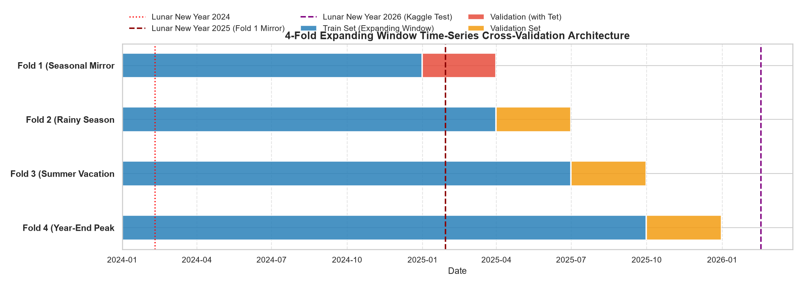
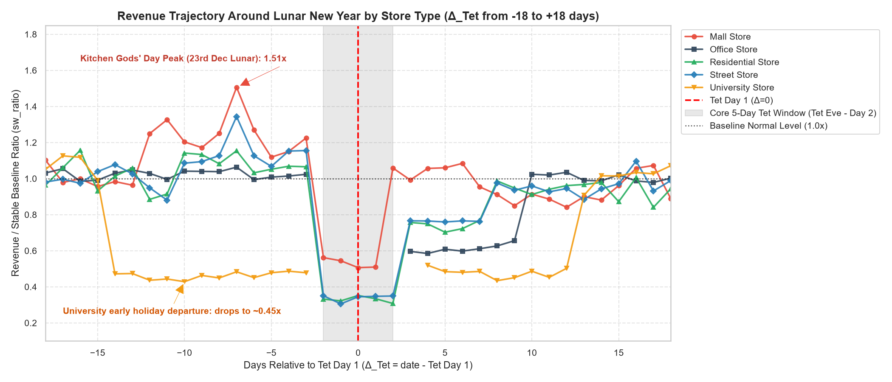
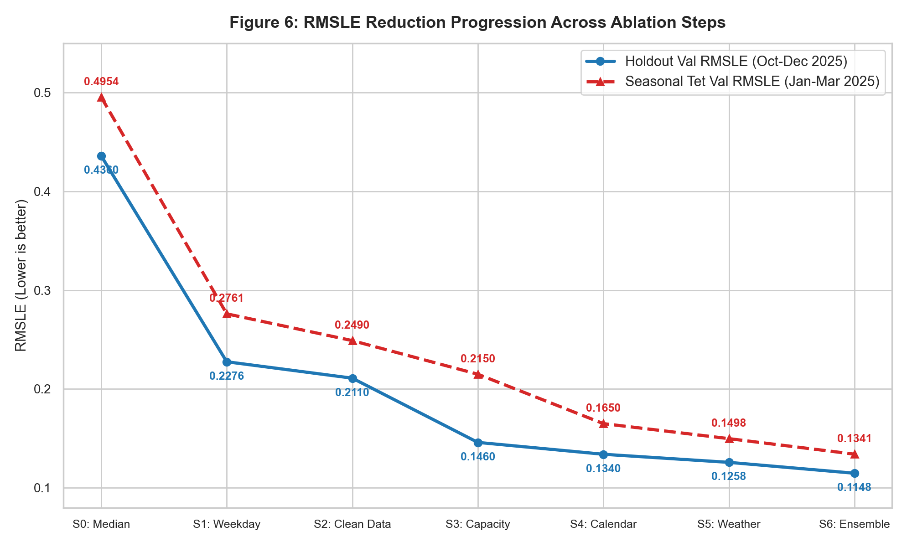
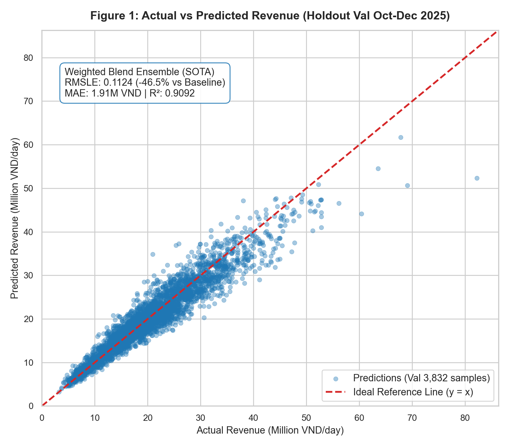
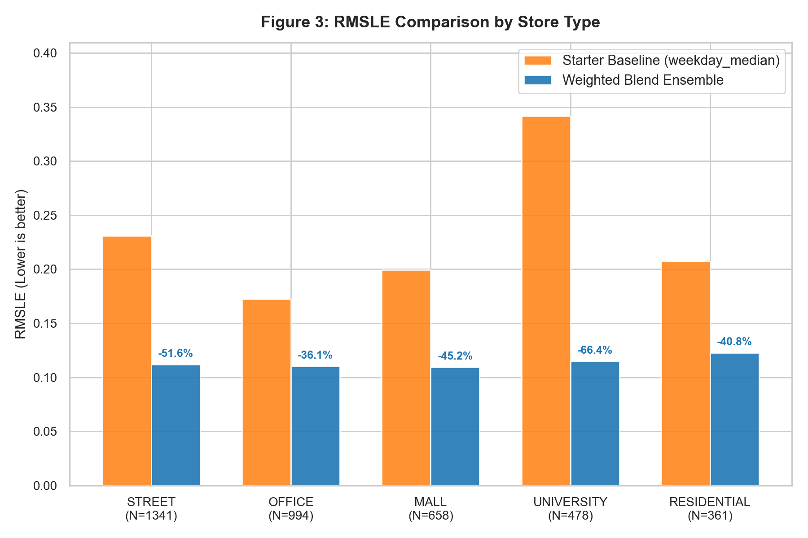
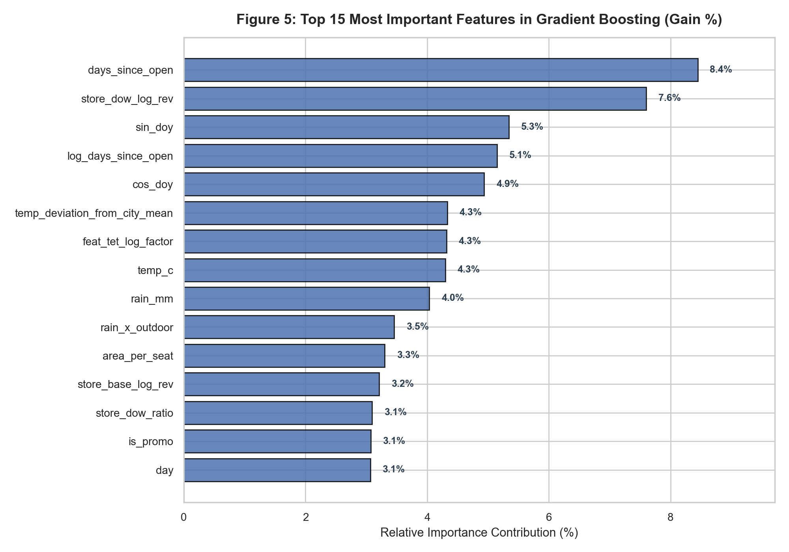

# ☕ Cafe Revenue Forecasting System

Hệ thống AI dự báo doanh thu ngày cho chuỗi **45 cửa hàng cà phê** tại Hà Nội và TP. Hồ Chí Minh (*Multi-Store Panel Time-Series Regression*), bao phủ toàn bộ quy trình từ thu thập và làm sạch dữ liệu thô, kỹ thuật đặc trưng chuyên sâu, kiểm định chéo chuỗi thời gian, huấn luyện và tối ưu tổ hợp mô hình đến triển khai **FastAPI REST API** và **Streamlit Dashboard**.

---

## 📋 Mục lục

1. [Tổng quan Bài toán & Kết quả Nổi bật](#-tổng-quan-bài-toán--kết-quả-nổi-bật)
2. [Kiến trúc Hệ thống & Quy trình 8 Bước](#-kiến-trúc-hệ-thống--quy-trình-8-bước)
3. [Cấu trúc Thư mục Dự án](#-cấu-trúc-thư-mục-dự-án)
4. [Bộ Dữ liệu & Các Vấn đề Dữ liệu Bẩn Đã Xử lý](#-bộ-dữ-liệu--các-vấn-đề-dữ-liệu-bẩn-đã-xử-lý)
5. [Kỹ thuật Đặc trưng & Mô hình Hóa Cốt lõi](#-kỹ-thuật-đặc-trưng--mô-hình-hóa-cốt-lõi)
6. [Trực quan hóa Kết quả Phân tích & Đánh giá](#-trực-quan-hóa-kết-quả-phân-tích--đánh-giá)
7. [Hướng dẫn Cài đặt & Khởi chạy](#-hướng-dẫn-cài-đặt--khởi-chạy)
8. [Tài liệu API (FastAPI) & Giao diện (Streamlit)](#-tài-liệu-api-fastapi--giao-diện-streamlit)
9. [Kiểm thử Tự động (Unit Tests)](#-kiểm-thử-tự-động-unit-tests)
10. [Tài liệu Tham khảo Nội bộ](#-tài-liệu-tham-khảo-nội-bộ)

---

## 🎯 Tổng quan Bài toán & Kết quả Nổi bật

- **Câu hỏi kinh doanh:** Dự báo doanh thu ngày (`revenue`, đơn vị: triệu VNĐ) cho **44 cửa hàng** trong tập kiểm tra (quán `S02` không có trong `test.csv`) xuyên suốt **Quý 1/2026** (`2026-01-01` → `2026-03-31`), giai đoạn chứa trọn kỳ nghỉ **Tết Nguyên Đán Bính Ngọ 2026** (Mùng 1 Tết: `2026-02-17`).
- **Thước đo đánh giá chính thức:** **RMSLE** (*Root Mean Squared Logarithmic Error*), phản ánh sai số tương đối theo phần trăm ở mọi quy mô cửa hàng:

$$\text{RMSLE}(y, \hat{y}) = \sqrt{\frac{1}{n} \sum_{i=1}^{n} \left( \ln(1 + \max(0, \hat{y}_i)) - \ln(1 + y_i) \right)^2}$$

### Kết quả Hiệu năng Mô hình (`artifacts/model_metrics_summary.json`)

| Chỉ số đánh giá | Starter Baseline (`weekday_median`) | Weighted Blend Ensemble (SOTA) | Mức cải thiện |
| :--- | :---: | :---: | :---: |
| **Holdout Validation RMSLE** (`Oct–Dec 2025`) | `0.2276` *(Clean)* / `0.2387` *(Raw)* | **`0.1103`** | **Giảm 52.0%** *(vs Clean)* |
| **Seasonal Tet RMSLE** (`Fold 1: Jan–Mar 2025`) | `0.2761` | **`0.1096`** | **Giảm 60.3%** |
| **4-Fold Time-Series CV Mean RMSLE** | `0.2546` | **`0.1103`** | **Ổn định đa mùa** |
| **Validation MAE** (triệu VNĐ/ngày) | `3.46` | **`1.81`** | Giảm `1.65` tr.VNĐ/ngày |
| **Validation RMSE** (triệu VNĐ/ngày) | `5.05` | **`2.54`** | Giảm `2.51` tr.VNĐ/ngày |
| **Hệ số xác định ($R^2$)** | `0.6710` | **`0.9185`** | Tăng `+0.2475` |

- **Cấu hình Weighted Blend Ensemble (SOTA — 12-Seed Bagged Enhanced):**
  - `CatBoostRegressor`: **60.0%**
  - `Ridge (L2 Linear)`: **20.0%**
  - `LGBMRegressor`: **10.0%**
  - `XGBRegressor`: **10.0%**
- **Tệp nộp bài `submission.csv`:** Đầy đủ **3,869 dòng** (`id` từ `100000` đến `103868`), 0 giá trị khuyết thiếu (`NaN`), toàn bộ doanh thu dự báo dương (Min: `2.14`, Median: `20.10`, Mean: `20.26`, Max: `62.77` triệu VNĐ).

> [!NOTE]
> Tệp [`artifacts/model_metrics_summary.json`](artifacts/model_metrics_summary.json) lưu kết quả từ cấu hình thử nghiệm mở rộng **12-Seed Bagged Enhanced** (92 đặc trưng số + 4 đặc trưng phân loại). Gói nhị phân `artifacts/cafe_revenue_bundle.joblib` được đưa vào `.gitignore` (không push lên GitHub) và sẽ được sinh cục bộ khi chạy [`src/step8_deploy.py`](src/step8_deploy.py) (cấu hình **10-Seed Bagging**, đồng bộ 77 đặc trưng số + 4 đặc trưng phân loại từ [`src/step3_preprocess.py`](src/step3_preprocess.py)) hoặc tự động sinh khi khởi động FastAPI backend. Khi chạy API/Streamlit cục bộ cho hàm dự báo đơn lẻ (`predict_single_instance`), nên chạy `python -m src.step8_deploy` trước để đồng bộ schema đặc trưng của bundle với `src/step3_preprocess.py`.

---

## 🏗 Kiến trúc Hệ thống & Quy trình 8 Bước

Toàn bộ dự án tuân thủ quy trình 8 bước chuẩn mực và 4 nguyên tắc chống rò rỉ dữ liệu (*Zero Data Leakage*):

```mermaid
flowchart LR
    A["1. Collect & Prepare<br/>5 bảng CSV + Safe Merge"] --> B["2. Explore (EDA)<br/>10 lỗi bẩn + 6 quy luật"]
    B --> C["3. Preprocess & FE<br/>Clean + 5 nhóm đặc trưng<br/>DeSeasonalizedStoreStats"]
    C --> D["4. Time-Based Split<br/>Holdout Q4/25 + 4-Fold CV"]
    D --> E["5. Scale & De-trend<br/>ColumnTransformer +<br/>TrendAwareLogTargetWrapper"]
    E --> F["6. Model & Train<br/>10 Models + Weighted Blend"]
    F --> G["7. Evaluate<br/>Ablation + Residuals + FI"]
    G --> H["8. Deploy<br/>submission.csv + Joblib<br/>FastAPI + Streamlit"]
```



---

## 📂 Cấu trúc Thư mục Dự án

```text
cafe-revenue-forecasting/
├── app/
│   ├── api_server.py                  # FastAPI REST backend (/health, /stores, /predict/*)
│   └── streamlit_app.py               # Streamlit interactive dashboard (4 tabs + local fallback)
├── artifacts/
│   ├── model_metrics_summary.json     # Tóm tắt chỉ số hiệu năng SOTA
│   └── (cafe_revenue_bundle.joblib)   # Sinh cục bộ sau khi chạy step8_deploy (được gitignore)
├── data/
│   ├── train.csv                      # Doanh thu ngày 2024–2025 (26,632 × 4)
│   ├── test.csv                       # Lịch cần dự báo Q1/2026 (3,869 × 4)
│   ├── stores.csv                     # Thuộc tính tĩnh 45 cửa hàng (45 × 8)
│   ├── weather.csv                    # Thời tiết ngày Hà Nội & TP.HCM (1,593 × 4)
│   ├── holidays.csv                   # Ngày lễ & sự kiện đặc biệt (55 × 3)
│   ├── sample_submission.csv          # Mẫu định dạng nộp bài Kaggle
│   └── starter_cafe.ipynb             # Notebook mốc chuẩn ban đầu (16 cells)
├── docs/
│   ├── step1_collect_and_prepare_report.md
│   ├── step2_explore_eda_report.md
│   ├── step3_preprocess_feature_engineering_report.md
│   ├── step4_time_based_split_report.md
│   ├── step5_scale_pipeline_report.md
│   ├── step6_model_train_report.md
│   ├── step7_evaluate_report.md
│   ├── step8_deploy_report.md
│   └── step9_optimization_report.md   # Phân tích & khắc phục ngoại suy xu thế vĩ mô
├── plots/
│   ├── eda_1_revenue_distribution.png
│   ├── eda_2_weather_temperature_fahrenheit.png
│   ├── eda_3_dow_store_type_interaction.png
│   ├── eda_4_tet_trajectory_by_store_type.png
│   ├── eda_5_store_lifecycle_ramp_up.png
│   ├── eda_6_feature_correlation_heatmap.png
│   ├── time_series_cv_timeline.png
│   ├── eval_1_actual_vs_predicted.png
│   ├── eval_2_residual_distribution.png
│   ├── eval_3_rmsle_by_store_type.png
│   ├── eval_4_store_ramp_up_curve.png
│   ├── eval_5_feature_importance_top20.png
│   └── eval_6_ablation_study_waterfall.png
├── src/
│   ├── __init__.py
│   ├── step1_collect_prepare.py       # Đọc dữ liệu, Data Dictionary, kiểm tra khóa & Safe Merge
│   ├── step2_explore.py               # Phát hiện 10 lỗi dữ liệu bẩn, EDA 6 quy luật & vẽ biểu đồ
│   ├── step3_preprocess.py            # Làm sạch dữ liệu, Feature Engineering & DeSeasonalizedStoreStats
│   ├── step4_split.py                 # Holdout Q4/2025, TimeSeriesExpandingCV & Baseline
│   ├── step5_scale.py                 # ColumnTransformer, TrendAwareLogTargetWrapper, MultiSeedBaggedPipeline
│   ├── step6_model_train.py           # 10 mô hình ứng viên, SLSQP WeightedBlendEnsemble & 4-Fold CV
│   ├── step7_evaluate.py              # Ablation Study, Store Type Breakdown, Residual Diagnostics & Plots
│   └── step8_deploy.py                # Retrain 100%, xuất submission.csv, đóng gói joblib & hàm inference
├── tests/                             # Bộ kiểm thử đơn vị unittest cho từng bước (tổng 53 test methods)
│   ├── test_step1.py ... test_step8.py
├── cafe_revenue_regression.ipynb      # Notebook trung tâm đầy đủ 8 bước (83 cells)
├── requirements.txt                   # Danh sách thư viện Python
└── submission.csv                     # Kết quả dự báo Q1/2026 chuẩn Kaggle (3,869 dòng)
```

---

## 🧹 Bộ Dữ liệu & Các Vấn đề Dữ liệu Bẩn Đã Xử lý

### Từ điển Dữ liệu (Data Dictionary)

| Bảng dữ liệu | Kích thước | Phạm vi thời gian | Khóa nối | Mô tả & Ghi chú |
| :--- | :---: | :---: | :---: | :--- |
| `train.csv` | `26,632 × 4` | `2024-01-01` → `2025-12-31` | `(store_id, date)` | Doanh thu lịch sử 45 quán (`is_promo`, `revenue`). |
| `test.csv` | `3,869 × 4` | `2026-01-01` → `2026-03-31` | `id`, `(store_id, date)` | Tập cần dự báo cho 44 quán (không gồm `S02`). |
| `stores.csv` | `45 × 8` | Tĩnh theo cửa hàng | `store_id` | `city`, `district`, `store_type`, `area_m2`, `seats`, `has_parking`, `open_date`. |
| `weather.csv` | `1,593 × 4` | `2024-01-01` → `2026-03-31` | `(city, date)` | `temp_c`, `rain_mm` tại Hà Nội và TP.HCM. |
| `holidays.csv` | `55 × 3` | `2024-01-01` → `2026-03-08` | `date` *(trùng khóa)* | Ngày nghỉ lễ quốc gia & sự kiện (53 ngày duy nhất). |

### 10 Vấn đề Dữ liệu Bẩn Phát hiện (Bước 2) & Cách Xử lý (Bước 3)

1. **Dòng trùng lặp (`train.csv`):** Loại bỏ **132 dòng** trùng lặp hoàn toàn, đưa `train` từ `26,632` về đúng `26,500` dòng duy nhất.
2. **Lỗi đơn vị 1000x (`train.csv`):** Xử lý **30 dòng** của quán `S12` trong tháng 03/2024 bị nhập nghìn VNĐ thay vì triệu VNĐ (`revenue > 1000` → chia `1000.0`).
3. **Lỗi dịch dấu thập phân 10x (`train.csv`):** Phát hiện và chia `10.0` cho **52 dòng** bất thường (`sw_ratio` so với trung vị `(store_id, dow)` vượt ngưỡng `3.8` hoặc `> 3.0` khi không phải ngày khai trương & không khuyến mãi).
4. **Lỗi dịch dấu thập phân 0.1x (`train.csv`):** Nhân `10.0` cho **26 dòng** bị tụt 10 lần (`sw_ratio < 0.18`).
5. **Không đồng nhất `store_type` (`stores.csv`):** Chuẩn hóa 9 nhãn hoa/thường lẫn lộn về đúng 5 loại chuẩn: `street`, `office`, `mall`, `university`, `residential`.
6. **Không đồng nhất `district` (`stores.csv`):** Ánh xạ thống nhất `Q.10` → `District 10`, `Quan 3` → `District 3`, `Quan 7` → `District 7`.
7. **Định dạng `open_date` hỗn hợp (`stores.csv`):** Pha trộn giữa `YYYY-MM-DD` và `DD/MM/YYYY`; chuẩn hóa an toàn bằng `pd.to_datetime(..., format="mixed", dayfirst=True)`.
8. **Khuyết diện tích `area_m2` (`stores.csv`):** Điền khuyết cho `S19` và `S24` theo tỷ lệ trung vị `area_per_seat` của từng `store_type`.
9. **Nhiệt độ ghi theo độ Fahrenheit (`weather.csv`):** Quy đổi cụm ngày nóng bất thường tại TP.HCM (`temp_c > 45`, tháng 06–07/2025) từ °F sang °C bằng $(T_F - 32) / 1.8$.
10. **Thiếu ngày thời tiết & NaN lượng mưa (`weather.csv`):** Mở rộng thành lưới chuẩn **1,642 dòng** (`821 ngày × 2 thành phố`), nội suy tuyến tính `temp_c` theo thành phố và điền `0.0` cho `rain_mm`.

> **Bảo toàn khóa nối (`holidays.csv`):** Do ngày `2024-02-14` và `2026-02-14` trùng cả *Tet holiday* và *Valentine's Day*, `prepare_holidays_table()` gộp nhóm theo `date` về 53 dòng duy nhất trước khi ghép bảng, ngăn chặn dội thêm 44 dòng trong `test.csv`.

---

## 🧠 Kỹ thuật Đặc trưng & Mô hình Hóa Cốt lõi

### 1. Hệ thống 5 Nhóm Đặc trưng (`src/step3_preprocess.py`)
Pipeline `run_step3()` tạo tổng cộng **90 cột** (`77 numeric` + `4 categorical` đưa vào mô hình, cùng 9 cột định danh/thời gian/target và `store_id` dùng cho mô hình cây & wrapper):
- **Thời gian & Chu kỳ (Calendar & Cyclical):** `dow`, `is_weekend`, `day`, `month`, `weekofyear`, `quarter`, biến đổi lượng giác `sin_dow`, `cos_dow`, `sin_doy`, `cos_doy`, trục thời gian liên tục `t_years`.
- **Tết Nguyên Đán & Ngày lễ:** `days_from_tet_clipped` (cắt trong `[-21, 21]` để triệt tiêu đa cộng tuyến với `month`), các cờ giai đoạn (`is_tet_core`, `is_pre_tet_shopping`, `is_ong_tao`, `is_post_tet_recovery`), cờ nghỉ hè/nghỉ Tết khối đại học (`is_uni_summer_break`, `is_uni_tet_break`), cùng các cờ tương tác đặc thù Việt Nam (`is_mall_pre_tet`, `is_mall_tet_recovery`, `is_street_post_tet`, `is_office_tet_closure`, `is_womens_day_*`, `is_valentine_*`).
- **Tĩnh & Vòng đời Cửa hàng (Lifecycle & Cold-Start):** `area_per_seat`, `days_since_open`, `log_days_since_open`, `is_grand_opening`, `is_ramp_up_phase`, `ramp_up_factor` (`1.70` trong 0–2 ngày khai trương; `0.61` → `0.86` trong ngày 3–60; `1.00` sau 60 ngày).
- **Thời tiết & Khuyến mãi:** `log_rain`, `is_heavy_rain`, `is_extreme_rain`, `temp_deviation_from_city_mean`, `rain_x_outdoor`, `rain_x_mall`, `promo_x_weekend`, `is_promo_friday`.
- **Tương tác Chuyên sâu Bổ sung:** `promo_x_uni`, `promo_x_mall`, `promo_x_street`, `promo_x_dow`, `is_pre_tet_mall_rush`, `is_pre_tet_street_rush`, `is_tet_core_slump`, `is_post_tet_office_ramp`, `is_post_tet_mall_bounce`, `tet_dist_smooth` (suy giảm Gaussian quanh tâm Tết), `rain_heavy_outdoor`.

### 2. Khử mùa vụ & Xử lý Quán mới (`DeSeasonalizedStoreStats`)
- Fit **độc lập trong từng fold huấn luyện** để đảm bảo không rò rỉ dữ liệu.
- Tính mức nền tĩnh trên các ngày bình thường sau khi khử đường cong chạy đà (`y_unramped_log`), giải quyết bài toán *Cold-Start* cho các quán mới mở cuối năm 2025 (`S01`, `S19`, `S45`) bằng mô hình phụ `Ridge` ước lượng công suất từ thuộc tính vật lý kết hợp co làm mượt **Empirical Bayes Shrinkage** ($m=10.0$), đồng thời trích xuất hệ số mùa Tết theo loại quán `feat_tet_log_factor`.

### 3. Kiểm định Chéo Chuỗi Thời gian (`src/step4_split.py`)
- **Split 1 (Starter Holdout):** Train `2024-01-01` → `2025-09-30` (`22,668` dòng), Validation `2025-10-01` → `2025-12-31` (`3,832` dòng).
- **Split 2 (`TimeSeriesExpandingCV` 4 Folds):** Mở rộng tập train theo từng quý trong năm 2025, trong đó **Fold 1 (Q1/2025)** đóng vai trò *Seasonal Mirror* phản chiếu trực tiếp cấu trúc Tết Nguyên Đán của tập Test Q1/2026.

### 4. Ngoại suy Xu thế & Multi-Seed Ensemble (`src/step5_scale.py`, `src/step6_model_train.py`, `src/step8_deploy.py`)
- **`TrendAwareLogTargetWrapper`:** Khắc phục điểm mù ngoại suy thời gian của các mô hình cây GBDT bằng cách ước lượng độ dốc tăng trưởng vĩ mô $\beta$ theo mô hình **Within-Store Panel Fixed Effects** (khử trung bình theo từng cửa hàng trên không gian $\ln(1 + y)$), huấn luyện trên chuỗi dừng $y^* = \ln(1 + y) - \beta t$ và tái hợp $\beta t$ khi dự báo Q1/2026.
- **10 Mô hình Ứng viên:** `DummyRegressor`, `Ridge`, `DecisionTreeRegressor`, `KNeighborsRegressor`, `SVR`, `MLPRegressor`, `HistGradientBoostingRegressor`, `LGBMRegressor`, `CatBoostRegressor`, `XGBRegressor`.
- **`MultiSeedBaggedPipeline` & `WeightedBlendEnsemble`:** Bagging đa hạt ngẫu nhiên cho các mô hình GBDT và hòa trộn lồi trên không gian $\ln(1 + y)$ để giảm phương sai và chống rung lắc (*shakeup*).

---

## 📊 Trực quan hóa Kết quả Phân tích & Đánh giá

| Kiến trúc Kiểm định Chéo 4-Fold | Quỹ đạo Doanh thu Quanh Tết Nguyên Đán |
| :---: | :---: |
|  |  |

| Tiến trình Giảm RMSLE (Ablation Study) | Đối chiếu Giá trị Thực tế vs Dự báo |
| :---: | :---: |
|  |  |

| Sai số RMSLE theo Loại Hình Cửa hàng | Top 15 Đặc trưng Quan trọng Nhất |
| :---: | :---: |
|  |  |

---

## 🚀 Hướng dẫn Cài đặt & Khởi chạy

### 1. Thiết lập Môi trường

Yêu cầu **Python 3.11+**. Tạo môi trường ảo và cài đặt các thư viện phụ thuộc:

```bash
python -m venv venv
```

Kích hoạt môi trường ảo:

- **Windows (PowerShell):**
  ```powershell
  .\venv\Scripts\Activate.ps1
  ```
- **Linux / macOS:**
  ```bash
  source venv/bin/activate
  ```

Cài đặt thư viện:

```bash
pip install -r requirements.txt
```

### 2. Chạy Pipeline Huấn luyện, Đánh giá & Đóng gói

Bạn có thể chạy theo **Notebook** hoặc theo **từng module Python**:

- **Chạy Notebook trung tâm:** Mở [`cafe_revenue_regression.ipynb`](cafe_revenue_regression.ipynb) (83 cells) và chọn **Run All**.
- **Chạy từng bước qua CLI:**
  ```bash
  python -m src.step1_collect_prepare
  python -m src.step2_explore
  python -m src.step3_preprocess
  python -m src.step4_split
  python -m src.step5_scale
  python -m src.step6_model_train
  python -m src.step7_evaluate
  python -m src.step8_deploy
  ```
  Trong đó `python -m src.step8_deploy` sẽ huấn luyện lại Ensemble trên 100% dữ liệu sạch (26,500 dòng), kiểm tra và xuất [`submission.csv`](submission.csv), đồng thời sinh gói `artifacts/cafe_revenue_bundle.joblib` (cục bộ) và cập nhật [`artifacts/model_metrics_summary.json`](artifacts/model_metrics_summary.json).
- **Tái tạo toàn bộ 13 biểu đồ vào `plots/`:**
  ```bash
  python -m src.step2_explore
  python -c "from src.step4_split import plot_cv_timeline; plot_cv_timeline()"
  python -m src.step7_evaluate
  ```

---

## 🌐 Tài liệu API (FastAPI) & Giao diện (Streamlit)

> **Lưu ý trước khi khởi chạy:** Nếu bạn sử dụng các endpoint dự báo đơn lẻ (`/predict/single`, `/predict/what-if`) hoặc Tab 1/2/3 trên Streamlit dựa vào hàm `predict_single_instance` / `predict_batch_dataframe` trong `src/step8_deploy.py`, hãy đảm bảo đã chạy `python -m src.step8_deploy` để bundle trên đĩa khớp đúng 81 đặc trưng (`77 numeric + 4 categorical`) của `src/step3_preprocess.py`.

### 1. Khởi chạy FastAPI Backend

```bash
uvicorn app.api_server:app --reload --port 8000
```

- Tài liệu tương tác **Swagger UI**: `http://localhost:8000/docs`
- Danh sách Endpoints:
  - `GET /` — Thông tin chào mừng & đường dẫn `/docs`, `/health`
  - `GET /health` — Kiểm tra trạng thái service, chỉ số mô hình và trọng số Ensemble
  - `GET /stores` — Danh sách 45 cửa hàng (hỗ trợ query `?city=...&store_type=...`)
  - `POST /predict/single` — Dự báo doanh thu 1 ngày + hiệu ứng khuyến mãi (*What-If Promo Uplift*) + khuyến nghị vận hành
  - `POST /predict/what-if` — So sánh song song *Base Scenario* vs *New Scenario* (khuyến mãi, nhiệt độ, lượng mưa)
  - `POST /predict/batch` — Dự báo hàng loạt theo danh sách bản ghi JSON

### 2. Khởi chạy Streamlit Dashboard

```bash
streamlit run app/streamlit_app.py
```

- Truy cập giao diện tại `http://localhost:8501` (hỗ trợ biến môi trường `API_BASE_URL`, mặc định `http://localhost:8000`).
- **Cơ chế Fallback thông minh:** Nếu FastAPI Backend chưa được bật, Streamlit tự động chuyển sang chế độ **Local Artifact Bundle** từ `artifacts/cafe_revenue_bundle.joblib`.
- **4 Tabs chức năng:**
  1. **🎯 Dự Báo Ngày & What-If:** Chọn quán, ngày, trạng thái khuyến mãi, nhiệt độ, lượng mưa; xem KPI, khuyến nghị vận hành và phân rã dự báo của từng mô hình thành phần.
  2. **📈 Lập Kế Hoạch Chuỗi Ngày & Mùa Tết:** Mô phỏng doanh thu theo khoảng ngày tùy chọn (ví dụ cao điểm Tết Bính Ngọ 2026) và biểu đồ xu hướng.
  3. **📂 Dự Báo Hàng Loạt (Kaggle Export):** Tải lên CSV tùy chỉnh hoặc dùng mặc định `data/test.csv`, chạy dự báo và tải về `submission.csv`.
  4. **📊 Đánh Giá Mô Hình & Khám Phá Dữ Liệu:** Hiển thị các chỉ số từ `model_metrics_summary.json` và 4 biểu đồ chẩn đoán trong `plots/`.

---

## 🧪 Kiểm thử Tự động (Unit Tests)

Thư mục [`tests/`](tests) chứa 8 module kiểm thử bằng thư viện chuẩn `unittest` (tổng cộng 53 test methods cho 8 bước):

```bash
# Chạy kiểm thử toàn bộ (unittest discover)
python -m unittest discover -s tests -v

# Chạy riêng từng bước
python -m unittest tests/test_step1.py -v
```

**Lưu ý về trạng thái kiểm thử hiện tại:**
- Nếu chạy `python -m unittest discover -s tests -v` trong môi trường cài theo `requirements.txt`:
  - `tests/test_step8.py` sử dụng `fastapi.testclient.TestClient`, yêu cầu cài đặt thêm thư viện `httpx` (hoặc `httpx2` tùy phiên bản Starlette/FastAPI) nếu muốn chạy test client của FastAPI.
  - `test_clean_train_outliers` trong [`tests/test_step3.py`](tests/test_step3.py) hiện kiểm tra điều kiện `revenue.max() < 100.0`, trong khi bản cập nhật `clean_train_outliers` ở [`src/step3_preprocess.py`](src/step3_preprocess.py) bỏ qua dòng có `days_since_open <= 2` nên dòng `S08` ngày `2025-08-06` (`days_since_open = -30`, `revenue = 239.8`) được giữ lại.

---

## 📚 Tài liệu Tham khảo Nội bộ

- Báo cáo chi tiết từng bước:
  - [`docs/step1_collect_and_prepare_report.md`](docs/step1_collect_and_prepare_report.md)
  - [`docs/step2_explore_eda_report.md`](docs/step2_explore_eda_report.md)
  - [`docs/step3_preprocess_feature_engineering_report.md`](docs/step3_preprocess_feature_engineering_report.md)
  - [`docs/step4_time_based_split_report.md`](docs/step4_time_based_split_report.md)
  - [`docs/step5_scale_pipeline_report.md`](docs/step5_scale_pipeline_report.md)
  - [`docs/step6_model_train_report.md`](docs/step6_model_train_report.md)
  - [`docs/step7_evaluate_report.md`](docs/step7_evaluate_report.md)
  - [`docs/step8_deploy_report.md`](docs/step8_deploy_report.md)
  - [`docs/step9_optimization_report.md`](docs/step9_optimization_report.md)
