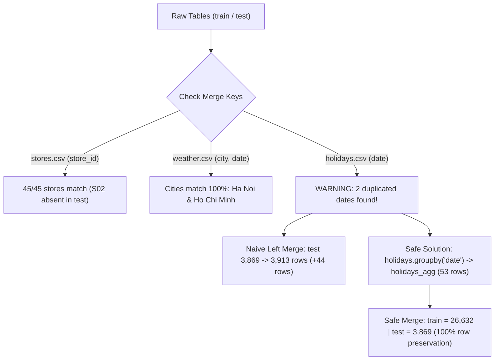

# BÁO CÁO TRIỂN KHAI TOÀN BỘ BƯỚC 1: COLLECT & PREPARE
## DỰ ÁN HỒI QUY DỰ BÁO DOANH THU CHUỖI QUÁN CAFE (*CAFE REVENUE REGRESSION*)

---

## 1. TỔNG QUAN KẾT QUẢ TRIỂN KHAI BƯỚC 1

Tuân thủ nghiêm ngặt theo tài liệu [Regression_Plan.md](file:///c:/Users/Admin/Desktop/cafe-revenue-forecasting/Regression_Plan.md#L33-L60) và quy chuẩn 8 bước của bài giảng Chương 4, toàn bộ nội dung của **Bước 1: Collect & Prepare** đã được lập trình hoàn chỉnh, kiểm thử tự động đạt 100% qua cả 2 hình thức:
1. **File Notebook duy nhất:** [`cafe_revenue_regression.ipynb`](file:///c:/Users/Admin/Desktop/cafe-revenue-forecasting/cafe_revenue_regression.ipynb) – Chứa đầy đủ Section 0 (Môi trường, seed, hàm RMSLE) và Section 1 (Định nghĩa bài toán, Data Dictionary, đối chiếu khóa nối, thực nghiệm dội dòng và thuật toán ghép bảng an toàn). Tất cả các cell đã được thực thi và lưu lại kết quả đầu ra trực quan.
2. **Module mã nguồn độc lập:** [`src/step1_collect_prepare.py`](file:///c:/Users/Admin/Desktop/cafe-revenue-forecasting/src/step1_collect_prepare.py) – Đóng gói thành các hàm chuyên biệt (`load_raw_data`, `build_data_dictionary`, `check_merge_keys`, `prepare_holidays_table`, `safe_merge_tables`, `run_step1`) phục vụ cho pipeline tái sử dụng trong các bước tiếp theo và ứng dụng FastAPI/Streamlit.
3. **Bộ kiểm thử tự động (Unit Tests):** [`tests/test_step1.py`](file:///c:/Users/Admin/Desktop/cafe-revenue-forecasting/tests/test_step1.py) – Vượt qua 7/7 test cases với thời gian chạy 0.565 giây.
4. **Tệp cấu hình môi trường:** [`requirements.txt`](file:///c:/Users/Admin/Desktop/cafe-revenue-forecasting/requirements.txt) – Khai báo đầy đủ các thư viện cần thiết theo kiến trúc dự án.

---

## 2. NỘI DUNG CHI TIẾT BƯỚC 1

### 2.1. Định nghĩa Bài toán Kinh doanh & Biến mục tiêu

- **Câu hỏi kinh doanh:** Mỗi cửa hàng trong chuỗi quán Cafe sẽ đạt doanh thu bao nhiêu (triệu VNĐ) vào từng ngày trong Quý 1/2026 (từ `2026-01-01` đến `2026-03-31`)?
- **Loại bài toán:** Hồi quy có giám sát trên dữ liệu bảng chuỗi thời gian đa cửa hàng (*Panel / Multi-Store Time-Series Regression*).
- **Biến mục tiêu (Target):** `revenue` (doanh thu ngày, đơn vị: triệu VNĐ, $y \ge 0$).
- **Thước đo đánh giá chính thức (Evaluation Metric):** RMSLE (*Root Mean Squared Logarithmic Error*):
  $$\text{RMSLE}(y, \hat{y}) = \sqrt{\frac{1}{n} \sum_{i=1}^{n} \left( \ln(1 + \max(0, \hat{y}_i)) - \ln(1 + y_i) \right)^2}$$
- **Ý nghĩa kinh tế & toán học:**
  - RMSLE phản ánh **sai số phần trăm tương đối** thay vì sai số tuyệt đối.
  - Dự báo lệch 10% tại một quán nhỏ khu dân cư (`residential`, doanh thu $\approx 7$ triệu VNĐ/ngày) bị phạt tương đương với việc dự báo lệch 10% tại một quán mặt phố lớn (`street`, doanh thu $\approx 30$ triệu VNĐ/ngày).
  - Biến đổi $\ln(1 + y)$ giúp chuẩn hóa phân phối có độ lệch phải lớn, bảo đảm các mô hình học máy không bị chi phối bởi các quán có quy mô doanh thu áp đảo.

---

### 2.2. Từ điển Dữ liệu (Data Dictionary) của 5 Bảng Dữ liệu

| Tên bảng | Kích thước (Dòng × Cột) | Phạm vi thời gian | Khóa chính / Nối | Kiểu dữ liệu & Danh sách cột chính | Giá trị khuyết (NaN) | Ý nghĩa kinh doanh trong dự án |
| :--- | :---: | :---: | :---: | :--- | :---: | :--- |
| [`train.csv`](file:///c:/Users/Admin/Desktop/cafe-revenue-forecasting/data/train.csv) | 26.632 × 4 | 2024-01-01 đến 2025-12-31 (731 ngày) | `(store_id, date)` | `date` (datetime64), `store_id` (str), `is_promo` (int64), `revenue` (float64) | 0 | Doanh thu ngày lịch sử của 45 quán trong 2 năm 2024–2025. |
| [`test.csv`](file:///c:/Users/Admin/Desktop/cafe-revenue-forecasting/data/test.csv) | 3.869 × 4 | 2026-01-01 đến 2026-03-31 (90 ngày) | `id`, `(store_id, date)` | `id` (int64), `date` (datetime64), `store_id` (str), `is_promo` (int64) | 0 | Tập dữ liệu cần dự báo cho 44 quán trong Quý 1/2026 (không có quán S02). |
| [`stores.csv`](file:///c:/Users/Admin/Desktop/cafe-revenue-forecasting/data/stores.csv) | 45 × 8 | Tĩnh theo cửa hàng | `store_id` | `store_id`, `city`, `district`, `store_type`, `area_m2`, `seats`, `has_parking`, `open_date` | 2 (cột `area_m2`) | Đặc tính vật lý, mặt bằng và ngày khai trương của 45 quán. |
| [`weather.csv`](file:///c:/Users/Admin/Desktop/cafe-revenue-forecasting/data/weather.csv) | 1.593 × 4 | 2024-01-01 đến 2026-03-31 (821 ngày) | `(city, date)` | `date` (datetime64), `city` (str), `temp_c` (float64), `rain_mm` (float64) | 16 (cột `rain_mm`) | Dữ liệu thời tiết theo ngày tại Hà Nội và TP.HCM. |
| [`holidays.csv`](file:///c:/Users/Admin/Desktop/cafe-revenue-forecasting/data/holidays.csv) | 55 × 3 | 2024-01-01 đến 2026-03-08 (53 ngày duy nhất) | `date` *(Bị lặp khóa!)* | `date` (datetime64), `holiday_name` (str), `type` (str) | 0 | Danh mục 55 sự kiện ngày lễ Quốc gia và sự kiện đặc biệt. |

---

### 2.3. Kiểm tra Tính toàn vẹn của Khóa nối & Cảnh báo Rủi ro Dội dòng

Áp dụng nguyên tắc vàng từ bài giảng Chương 4:
> *"Compare shape before and after a merge: more rows means the key is repeated in the right table."*



#### Các phát hiện định lượng:
1. **Khóa `store_id`:**
   - Tập `train` có 45 cửa hàng $\subseteq$ `stores.csv` (100% khớp).
   - Tập `test` có 44 cửa hàng $\subseteq$ `stores.csv` (100% khớp). Quán duy nhất không cần dự báo ở test là `S02`.
2. **Khóa `city`:**
   - Các thành phố trong `stores.csv` gồm: `['Ha Noi', 'Ho Chi Minh']`.
   - Các thành phố trong `weather.csv` gồm: `['Ha Noi', 'Ho Chi Minh']`. Khớp 100%.
3. **Phát hiện rủi ro trùng lặp khóa trong `holidays.csv`:**
   - Có **2 ngày bị lặp khóa `date`**:
     - Ngày `2024-02-14`: gồm `Tet holiday` (`national_holiday`) và `Valentine's Day` (`event`).
     - Ngày `2026-02-14`: gồm `Tet holiday` (`national_holiday`) và `Valentine's Day` (`event`).
4. **Hậu quả của Naive Merge:**
   - Nếu merge trực tiếp `test.merge(holidays, on='date', how='left')`, mỗi cửa hàng trong 44 cửa hàng của tập test vào ngày 14/02/2026 sẽ bị ghép thành 2 dòng.
   - Số dòng của tập test bị tăng từ **3.869 lên 3.913 dòng** (thừa đúng 44 dòng), làm hỏng định dạng file nộp bài Kaggle (`submission.csv`), khiến hệ thống chấm điểm từ chối bài thi!

---

### 2.4. Thuật toán Tiền xử lý `holidays_agg` & Ghép bảng An toàn (Safe Merge)

Để ngăn chặn hoàn toàn rủi ro dội dòng, thuật toán tổng hợp được cài đặt như sau:

```python
holidays_agg = holidays.groupby("date").agg(
    is_national_holiday=("type", lambda s: int((s == "national_holiday").any())),
    is_event_holiday=("type", lambda s: int((s == "event").any())),
    holiday_name_clean=("holiday_name", lambda s: " + ".join(s))
).reset_index()
```

- Bảng `holidays.csv` (55 dòng) được rút gọn về đúng **53 dòng duy nhất**, trong đó ngày 14/02 của cả năm 2024 và 2026 được gán:
  - `is_national_holiday = 1`
  - `is_event_holiday = 1`
  - `holiday_name_clean = "Tet holiday + Valentine's Day"`
- Tiến hành ghép nối an toàn theo 3 tầng liên tiếp và kiểm định bằng `assert`:
  1. Tầng 1: `base.merge(stores, on="store_id", how="left")`
  2. Tầng 2: `base.merge(weather, on=["city", "date"], how="left")`
  3. Tầng 3: `base.merge(holidays_agg, on="date", how="left")`
- Các ngày thường không có sự kiện được điền giá trị mặc định: `is_national_holiday = 0`, `is_event_holiday = 0`, `holiday_name_clean = 'None'`.

---

### 2.5. Kết quả Ghép bảng Sau Bước 1

Số dòng và số cột của hai bảng dữ liệu sau ghép nối:
- `train_merged`: **26.632 dòng × 16 cột** (Bảo toàn 100% so với `train.csv` ban đầu).
- `test_merged`: **3.869 dòng × 16 cột** (Bảo toàn 100% so với `test.csv` ban đầu).

Danh mục 16 cột trong bảng dữ liệu hợp nhất:
1. `date` (`datetime64[ns]`): Ngày kinh doanh
2. `store_id` (`object`): Mã cửa hàng (S01 – S45)
3. `is_promo` (`int64`): Trạng thái chạy chương trình khuyến mãi (0 hoặc 1)
4. `revenue` (`float64`): Doanh thu ngày (triệu VNĐ, chỉ có ở train; test có `id`)
5. `city` (`object`): Thành phố (Ha Noi / Ho Chi Minh)
6. `district` (`object`): Quận
7. `store_type` (`object`): Loại hình vị trí (street, office, mall, university, residential)
8. `area_m2` (`float64`): Diện tích mặt bằng ($m^2$)
9. `seats` (`int64`): Số lượng chỗ ngồi
10. `has_parking` (`int64`): Có bãi đỗ xe hay không (0 hoặc 1)
11. `open_date` (`object`): Ngày khai trương cửa hàng
12. `temp_c` (`float64`): Nhiệt độ trung bình ngày (°C)
13. `rain_mm` (`float64`): Lượng mưa trong ngày (mm)
14. `is_national_holiday` (`int64`): Cờ ngày nghỉ lễ quốc gia (0 hoặc 1)
15. `is_event_holiday` (`int64`): Cờ ngày sự kiện đặc biệt (0 hoặc 1)
16. `holiday_name_clean` (`object`): Tên sự kiện lễ/hội

---

## 3. KẾT QUẢ KIỂM THỬ (UNIT TESTS)

Tất cả 7 bài kiểm tra tự động trong [`tests/test_step1.py`](file:///c:/Users/Admin/Desktop/cafe-revenue-forecasting/tests/test_step1.py) đều đạt kết quả hoàn hảo:
```text
.......
----------------------------------------------------------------------
Ran 7 tests in 0.565s

OK
```
1. `test_rmsle_exact`: Kiểm tra tính toán RMSLE chính xác tuyệt đối.
2. `test_load_raw_data_shapes`: Kiểm tra kích thước 5 bảng dữ liệu nạp vào.
3. `test_build_data_dictionary`: Kiểm tra cấu trúc bảng Từ điển Dữ liệu.
4. `test_check_merge_keys`: Kiểm tra tính toàn vẹn khóa nối, cảnh báo quán S02 và rủi ro dội 44 dòng.
5. `test_prepare_holidays_table`: Kiểm tra gộp nhóm holidays 53 dòng duy nhất.
6. `test_safe_merge_tables_preservation`: Kiểm tra bảo toàn số dòng tuyệt đối cho `train` (26.632) và `test` (3.869).
7. `test_run_step1_end_to_end`: Kiểm tra tích hợp toàn trình hàm `run_step1()`.

---

## 4. KẾT LUẬN & SẴN SÀNG CHUYỂN BƯỚC

BƯỚC 1 đã được triển khai hoàn chỉnh, đúng quy chuẩn học thuật và kế hoạch thực thi, tạo nền móng vững chắc để bước vào **BƯỚC 2: EXPLORE (KHÁM PHÁ DỮ LIỆU - EDA & PHÁT HIỆN LỖI DỮ LIỆU BẨN)**.
