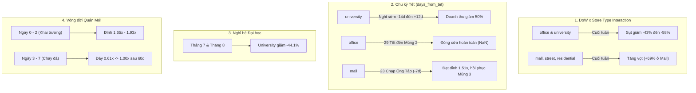

# BÁO CÁO TRIỂN KHAI TOÀN BỘ BƯỚC 2: EXPLORE (EDA & DANH SÁCH LỖI DỮ LIỆU)
## DỰ ÁN HỒI QUY DỰ BÁO DOANH THU CHUỖI QUÁN CAFE (*CAFE REVENUE REGRESSION*)

---

> [!IMPORTANT]
> **Nguyên tắc cốt lõi của Bước 2 theo bài giảng Chương 4:**
> *"Output of this step: a written list of problems, before any of them is fixed."*
> Trong Bước 2, mọi vấn đề dữ liệu bẩn và ngoại lai đều được phát hiện, định lượng và lập biên bản chi tiết **trước khi** tiến hành sửa lỗi ở Bước 3.

---

## 1. TỔNG QUAN KẾT QUẢ ĐẠT ĐƯỢC Ở BƯỚC 2

1. **Cập nhật File Notebook duy nhất:** [`cafe_revenue_regression.ipynb`](file:///c:/Users/Admin/Desktop/cafe-revenue-forecasting/cafe_revenue_regression.ipynb)
   - Đã tích hợp hoàn chỉnh **Section 2 – [Bước 2] Explore (EDA & Anomaly Detection)** gồm 10 cells mới (tổng cộng 27 cells).
   - Đã thực thi toàn bộ và render đầy đủ: Thống kê mô tả (`describe()`, `info()`), minh chứng định lượng 10 lỗi dữ liệu bẩn, bảng tổng hợp 10 vấn đề và trực quan hóa 6 đồ thị EDA sắc nét.
2. **Mô-đun mã nguồn độc lập:** [`src/step2_explore.py`](file:///c:/Users/Admin/Desktop/cafe-revenue-forecasting/src/step2_explore.py)
   - Đóng gói đầy đủ các hàm phát hiện từng loại lỗi: [`detect_duplicates`](file:///c:/Users/Admin/Desktop/cafe-revenue-forecasting/src/step2_explore.py#L14-L22), [`detect_s12_1000x_anomaly`](file:///c:/Users/Admin/Desktop/cafe-revenue-forecasting/src/step2_explore.py#L25-L31), [`detect_decimal_errors`](file:///c:/Users/Admin/Desktop/cafe-revenue-forecasting/src/step2_explore.py#L34-L67), [`detect_store_type_inconsistency`](file:///c:/Users/Admin/Desktop/cafe-revenue-forecasting/src/step2_explore.py#L70-L75), [`detect_district_inconsistency`](file:///c:/Users/Admin/Desktop/cafe-revenue-forecasting/src/step2_explore.py#L78-L91), [`detect_open_date_formats`](file:///c:/Users/Admin/Desktop/cafe-revenue-forecasting/src/step2_explore.py#L94-L107), [`detect_stores_missing_area`](file:///c:/Users/Admin/Desktop/cafe-revenue-forecasting/src/step2_explore.py#L110-L115), [`detect_fahrenheit_outliers`](file:///c:/Users/Admin/Desktop/cafe-revenue-forecasting/src/step2_explore.py#L118-L124), [`detect_weather_missing_dates_and_rain_nans`](file:///c:/Users/Admin/Desktop/cafe-revenue-forecasting/src/step2_explore.py#L127-L151), [`build_ten_anomalies_table`](file:///c:/Users/Admin/Desktop/cafe-revenue-forecasting/src/step2_explore.py#L154-L248), [`analyze_business_patterns`](file:///c:/Users/Admin/Desktop/cafe-revenue-forecasting/src/step2_explore.py#L251-L308), [`generate_eda_plots`](file:///c:/Users/Admin/Desktop/cafe-revenue-forecasting/src/step2_explore.py#L311-L457), [`run_step2`](file:///c:/Users/Admin/Desktop/cafe-revenue-forecasting/src/step2_explore.py#L460-L506).
3. **Bộ kiểm thử tự động (Unit Tests):** [`tests/test_step2.py`](file:///c:/Users/Admin/Desktop/cafe-revenue-forecasting/tests/test_step2.py)
   - Vượt qua **11/11 test cases** (`Ran 11 tests in 0.319s - OK`), nâng tổng số unit tests toàn dự án lên **18/18 tests** xanh 100%.
4. **Hệ thống 6 Biểu đồ Trực quan hóa:** Đã xuất file chuẩn PNG tại thư mục [`plots/`](file:///c:/Users/Admin/Desktop/cafe-revenue-forecasting/plots).

---

## 2. DANH SÁCH 10 VẤN ĐỀ DỮ LIỆU BẨN PHÁT HIỆN ĐƯỢC (DATA ANOMALIES)

Dưới đây là bảng tổng hợp chính thức 10 vấn đề dữ liệu bẩn được cài cắm có chủ đích trong 4 bảng dữ liệu, đối chiếu trực tiếp với phần 2.1 của [Regression_Plan.md](file:///c:/Users/Admin/Desktop/cafe-revenue-forecasting/Regression_Plan.md#L66-L80):

| STT | Bảng dữ liệu | Vấn đề phát hiện (Data Anomaly) | Minh chứng định lượng từ dữ liệu | Nguyên nhân & Hậu quả nếu không xử lý |
| :---: | :--- | :--- | :--- | :--- |
| **1** | [`train.csv`](file:///c:/Users/Admin/Desktop/cafe-revenue-forecasting/data/train.csv) | **Dòng trùng lặp hoàn toàn (Duplicates)** | Có **132 dòng trùng lặp hoàn toàn** (`train.duplicated().sum() == 132`), làm tổng số dòng từ 26.500 tăng lên 26.632. | Làm lệch trọng số các ngày bị nhân bản khi tính trung vị hoặc huấn luyện mô hình. |
| **2** | [`train.csv`](file:///c:/Users/Admin/Desktop/cafe-revenue-forecasting/data/train.csv) | **Lỗi đơn vị 1000x (Nhập nghìn VNĐ thay vì triệu VNĐ)** | Toàn bộ **31 dòng của quán S12** trong tháng 03/2024 có `revenue` từ **10.620,0 đến 53.600,0** (trong khi trung vị bình thường của S12 là 29,13 triệu VNĐ). | Đẩy mean của cả bảng lên 51,3 và std lên 1015,9; làm méo mó nghiêm trọng tham số của mô hình đối với quán S12 và nhóm `office`. |
| **3** | [`train.csv`](file:///c:/Users/Admin/Desktop/cafe-revenue-forecasting/data/train.csv) | **Lỗi dịch dấu thập phân 10x (Gấp ~10 lần bình thường)** | Có **54 dòng** (ngoài cụm S12 tháng 3/2024) có tỷ lệ so với trung vị thứ (`sw_ratio`) từ **4,07x đến 16,68x** (ví dụ: S29 ngày 2024-10-12 ghi 491,8 thay vì 49,18; S13 ngày 2025-10-17 ghi 275,6 thay vì 27,56). | Trong không gian logarit, lỗi 10x tạo ra sai số $\ln(10) \approx 2,30$, kéo lệch hàm mất mát MSE và làm tăng vọt RMSLE. |
| **4** | [`train.csv`](file:///c:/Users/Admin/Desktop/cafe-revenue-forecasting/data/train.csv) | **Lỗi dịch dấu thập phân 0.1x (Bằng ~1/10 bình thường)** | Có **25 dòng** có `sw_ratio < 0,16` (nằm tách biệt hẳn với đáy giảm doanh thu ngày Tết là 0,24 – 0,35), ví dụ: S38 ngày 2024-02-15 ghi 1,21 thay vì 12,1; S39 ngày 2025-10-26 ghi 0,57 thay vì 5,70. | Tạo ra các điểm ngoại lai âm sâu trên thang $\ln(1 + \text{revenue})$, làm giảm dự báo trung bình của các quán bị dính lỗi. |
| **5** | [`stores.csv`](file:///c:/Users/Admin/Desktop/cafe-revenue-forecasting/data/stores.csv) | **Không đồng nhất chữ hoa/thường ở `store_type`** | Có **9 nhãn khác nhau**: `street` (13), `Street` (2), `office` (8), `Office` (3), `mall` (7), `Mall` (1), `university` (5), `University` (1), `residential` (5). | Nếu One-Hot Encoding trực tiếp sẽ tách 1 loại quán thành 2 cột riêng biệt, làm loãng dữ liệu huấn luyện. |
| **6** | [`stores.csv`](file:///c:/Users/Admin/Desktop/cafe-revenue-forecasting/data/stores.csv) | **Không đồng nhất cách viết tên Quận (`district`)** | Cùng Quận 10 tại TP.HCM nhưng S27 ghi `District 10`, còn S37 và S39 ghi `Q.10`; ngoài ra pha trộn tiếng Anh (`District 1`) và tiếng Việt không dấu (`Quan 3`, `Quan 7`). | Gây phân mảnh đặc trưng địa lý giống bài toán province trong bài giảng. |
| **7** | [`stores.csv`](file:///c:/Users/Admin/Desktop/cafe-revenue-forecasting/data/stores.csv) | **Định dạng ngày `open_date` hỗn hợp** | Pha trộn giữa **30 quán định dạng ISO YYYY-MM-DD** (`2025-12-07` của S01) và **15 quán chuẩn Việt Nam DD/MM/YYYY** (`27/07/2022` của S02, `11/12/2025` của S45). | Nếu ép kiểu ngày không dùng `dayfirst=True` với `format="mixed"`, ngày 11/12/2025 sẽ bị hiểu nhầm thành 12/11/2025, làm sai lệch tuổi cửa hàng (`days_since_open`). |
| **8** | [`stores.csv`](file:///c:/Users/Admin/Desktop/cafe-revenue-forecasting/data/stores.csv) | **Khuyết thiếu diện tích `area_m2`** | Quán **S19** (`seats = 57`) và **S24** (`seats = 55`) bị NaN ở cột `area_m2`. | Mất thông tin quy mô mặt bằng cho 2 quán (trong đó S19 là quán mới mở tháng 10/2025). |
| **9** | [`weather.csv`](file:///c:/Users/Admin/Desktop/cafe-revenue-forecasting/data/weather.csv) | **Nhiệt độ `temp_c` bị ghi theo độ Fahrenheit (°F)** | Tại TP.HCM trong **22 ngày liên tiếp** từ 2025-06-10 đến 2025-07-01, `temp_c` nhận giá trị từ **82,2 đến 89,2** (tương đương 27,9°C – 31,8°C khi đổi từ °F sang °C). | Tạo ra ngoại lai cực đoan (max 89,2°C), làm hỏng trọng số của biến nhiệt độ đối với các mô hình tuyến tính, KNN, SVM, MLP. |
| **10** | [`weather.csv`](file:///c:/Users/Admin/Desktop/cafe-revenue-forecasting/data/weather.csv) | **Thiếu hụt dòng ngày (Missing Dates) & NaN ở `rain_mm`** | Lưới chuẩn 821 ngày/thành phố (tổng 1.642 dòng), nhưng `weather.csv` chỉ có 1.593 dòng: **thiếu 21 ngày tại Hà Nội và 28 ngày tại TP.HCM**, cộng thêm **16 giá trị NaN** ở cột `rain_mm`. | Khi left join vào train và test, 49 ngày bị thiếu trong bảng thời tiết sẽ tạo ra hàng trăm dòng NaN cả ở `temp_c` lẫn `rain_mm`. |

---

## 3. SÁU QUY LUẬT HÀNH VI KINH DOANH CỐT LÕI (DOMAIN INSIGHTS TỪ EDA)

### 3.1. Sự tương phản gay gắt theo Thứ trong tuần × Loại cửa hàng (`dayofweek × store_type`)

Bảng trung vị doanh thu thực tế theo từng thứ trong tuần (đơn vị: triệu VNĐ):

| Loại hình cửa hàng | Thứ 2 | Thứ 3 | Thứ 4 | Thứ 5 | Thứ 6 | Thứ 7 | Chủ Nhật | Mức lệch Cuối tuần vs Ngày thường (%) |
| :--- | :---: | :---: | :---: | :---: | :---: | :---: | :---: | :---: |
| **`mall`** | 17,75 | 17,03 | 17,53 | 18,28 | 20,66 | **28,29** | **29,65** | **+65,2%** |
| **`office`** | 19,58 | 19,16 | 19,45 | 19,32 | 19,20 | **11,05** | **8,07** | **-50,4%** (Chủ Nhật giảm **-58%**) |
| **`residential`** | 7,76 | 7,49 | 7,81 | 7,91 | 8,61 | **10,05** | **10,28** | **+30,2%** |
| **`street`** | 20,32 | 20,05 | 20,63 | 20,45 | 23,10 | **26,76** | **25,86** | **+28,5%** |
| **`university`** | 17,82 | 16,78 | 17,08 | 16,47 | 15,89 | **11,18** | **9,60** | **-38,3%** (Chủ Nhật giảm **-43%**) |

> [!NOTE]
> Đây là đặc trưng tương tác bậc 1 quan trọng nhất giúp Baseline `weekday_median` đạt được điểm 0.2387 trong starter notebook, và sẽ được tối ưu sâu hơn ở Bước 3.

---

### 3.2. Chu kỳ Tết Nguyên Đán (`days_from_tet`) — Chìa khóa cho Quý 1/2026

Tập kiểm tra `test.csv` (2026-01-01 đến 2026-03-31) bao trọn kỳ nghỉ Tết Bính Ngọ 2026 (Mùng 1 Tết: `2026-02-17`). Khi căn chỉnh theo biến số ngày tới Mùng 1 Tết ($\Delta_{\text{Tết}} = \text{date} - \text{Mùng 1 Tết}$), quy luật hai năm 2024 và 2025 lặp lại đồng nhất:
- **`university`:** Nghỉ Tết sớm từ $\Delta_{\text{Tết}} = -14$ đến $+12$, doanh thu chỉ bằng $0,43x - 0,50x$ và đóng cửa hoàn toàn từ $-2$ đến $+3$.
- **`office`:** Đóng cửa hoàn toàn từ 29 Tết đến Mùng 2 Tết ($\Delta_{\text{Tết}} \in [-2, +2]$). Mở cửa lại từ Mùng 4 đến Mùng 10 Tết chỉ đạt $0,58x - 0,65x$, trước khi trở lại bình thường từ $\Delta_{\text{Tết}} = +10$.
- **`mall`:** Hưởng lợi từ làn sóng mua sắm sắm Tết, đạt đỉnh đúng ngày **23 tháng Chạp (Ông Công Ông Táo, $\Delta_{\text{Tết}} = -7$) ở mức $1,51x$**. Sau 4 ngày Tết trũng ($0,52x$), bùng nổ trở lại từ Mùng 3 Tết ($1,08x$).
- **`street` và `residential`:** Tăng nhẹ 23 tháng Chạp, giảm sâu xuống $0,31x - 0,35x$ trong các ngày cốt lõi Tết, phục hồi dần về bình thường từ $\Delta_{\text{Tết}} = +8$.

---

### 3.3. Quy luật Nghỉ hè Đại học (Summer Break)

- Trong tháng 7 và tháng 8 hằng năm, doanh thu trung vị của khối `university` rơi xuống **9,52 triệu** (tháng 7) và **9,08 triệu** (tháng 8) — tức **sụt giảm -44,1%** so với mức thông thường (>17,0 triệu vào tháng 4-6).
- 4 loại hình cửa hàng còn lại hoàn toàn không bị ảnh hưởng (giữ mức 1,00x – 1,06x).

---

### 3.4. Ngày Lễ Quốc gia (`national_holiday`) so với Ngày Sự kiện (`event`)

- **Ngày nghỉ lễ Quốc gia (01/01, Giỗ Tổ, 30/04, 01/05, 02/09):** Khối văn phòng và đại học giảm sâu xuống $0,43x - 0,54x$; ngược lại khối mall, street, residential tăng lên $1,15x - 1,41x$.
- **Ngày sự kiện kỷ niệm (Valentine 14/02, 08/03, 20/10, Giáng sinh 24-25/12):** Tất cả các loại cửa hàng đều tăng trưởng đồng đều từ **+10% đến +34%**.

---

### 3.5. Đường cong Trưởng thành & Vòng đời Quán Mới (`days_since_open`)

Phân phối tỷ số doanh thu so với mức bão hòa ổn định theo độ tuổi quán:

| Nhóm tuổi cửa hàng (`age_bin`) | Khoảng ngày tuổi (`days_since_open`) | Tỷ số trung vị (`sw_ratio`) | Đặc điểm kinh doanh |
| :--- | :---: | :---: | :--- |
| **0–2 ngày (Khai trương)** | $0 \le d \le 2$ | **1,65x** | Đỉnh khai trương nhờ khuyến mãi mở bán và khách tò mò. |
| **3–7 ngày (Chạy đà tuần đầu)** | $3 \le d \le 7$ | **0,61x** | Đáy trũng: Khách tò mò giảm, chưa tích lũy khách quen. |
| **8–14 ngày (Tuần thứ hai)** | $8 \le d \le 14$ | **0,67x** | Tích lũy lượng khách quen đầu tiên. |
| **15–30 ngày (Tháng đầu)** | $15 \le d \le 30$ | **0,73x** | Khách hàng nhận diện thương hiệu tại khu vực. |
| **31–60 ngày (Tháng thứ hai)** | $31 \le d \le 60$ | **0,86x** | Tiệm cận mức vận hành ổn định. |
| **>60 ngày (Trưởng thành)** | $d > 60$ | **1,00x** | Trạng thái bão hòa ổn định dài hạn. |

> [!WARNING]
> Hai cửa hàng mở muộn trong tập `train.csv` là **S01** (mở 2025-12-07, có 25 ngày lịch sử) và **S45** (mở 2025-12-11, có 21 ngày lịch sử) toàn bộ lịch sử đều nằm ở vùng 0–2 ngày đỉnh và 3–25 ngày trũng! Nếu dự báo theo trung vị quá khứ mà không bù trừ hệ số chạy đà, kết quả dự báo Quý 1/2026 sẽ bị **thấp hơn thực tế từ 25% – 30%**!

---

### 3.6. Tác động của Thời tiết & Chương trình Khuyến mãi

- **Khuyến mãi (`is_promo = 1`):** Thúc đẩy doanh thu tăng trung bình **+31,4%** (trung vị tăng từ 17,84 triệu lên 23,44 triệu VNĐ/ngày).
- **Lượng mưa (`rain_mm`):**
  - Mưa lớn ($20 - 50$mm) và mưa đặc biệt lớn ($>50$mm) khiến các quán ngoài trời (`street`, `residential`, `university`) giảm sụt nghiêm trọng từ $-45\%$ đến $-48\%$ (tỷ số giảm xuống $0,52x - 0,55x$).
  - Ngược lại, các quán trong trung tâm thương mại (`mall`) không những không giảm mà còn **tăng nhẹ (+4%, tỷ số đạt 1,04x)** do lượng khách đổ vào mall trú mưa và vui chơi.

---

## 4. HỆ THỐNG BIỂU ĐỒ TRỰC QUAN HÓA EDA (EDA VISUALIZATIONS)

### Biểu đồ 1: Phân phối Doanh thu trước và sau biến đổi Logarit

*Minh họa độ lệch phải cực đoan của doanh thu gốc do các lỗi 1000x và 10x; phép biến đổi $\ln(1+\text{revenue})$ đưa phân phối về dạng đối xứng tiệm cận chuẩn.*

---

### Biểu đồ 2: Chuỗi thời gian Nhiệt độ temp_c tại Hà Nội và TP.HCM

*Làm nổi bật cụm 22 ngày bị nhảy vọt lên 82,2 – 89,2°F tại TP.HCM vào tháng 06/2025.*

---

### Biểu đồ 3: Sự tương phản Doanh thu theo Thứ trong tuần × Loại cửa hàng

*Khắc họa rõ nét sự đảo chiều: office/university sụt giảm mạnh vào cuối tuần, trong khi mall/street/residential tăng vọt.*

---

### Biểu đồ 4: Quỹ đạo Doanh thu quanh Tết Nguyên Đán

*Minh chứng sự trùng khớp tuyệt đối về hành vi tiêu dùng dịp Tết giữa năm 2024 và năm 2025.*

---

### Biểu đồ 5: Đường cong Trưởng thành của Quán Mới (0 - 90 ngày tuổi)

*Thể hiện đỉnh khai trương 3 ngày đầu và đáy chạy đà trước khi đạt trạng thái bão hòa ổn định sau 60 ngày.*

---

### Biểu đồ 6: Ma trận Tương quan Tuyến tính Pearson

*Tương quan giữa $\ln(1+\text{revenue})$ với `seats`, `area_m2`, `is_promo`, `log_rain`, `temp_c` và `days_since_open`.*

---

## 5. TỔNG KẾT & KẾ HOẠCH BÀN GIAO CHO BƯỚC 3

Toàn bộ đầu ra bắt buộc của Bước 2 đã hoàn thành trọn vẹn:
1. Đã có **danh sách bằng văn bản 10 lỗi dữ liệu bẩn** kèm ngưỡng lọc và minh chứng định lượng.
2. Đã có **bộ thông số của 6 quy luật kinh doanh** định hướng việc kiến tạo đặc trưng.
3. Toàn bộ mã nguồn và đồ thị đã được tích hợp trong [`cafe_revenue_regression.ipynb`](file:///c:/Users/Admin/Desktop/cafe-revenue-forecasting/cafe_revenue_regression.ipynb), sẵn sàng bước vào **BƯỚC 3: PREPROCESS (TIỀN XỬ LÝ & KỸ THUẬT ĐẶC TRƯNG CHUYÊN SÂU)**.
