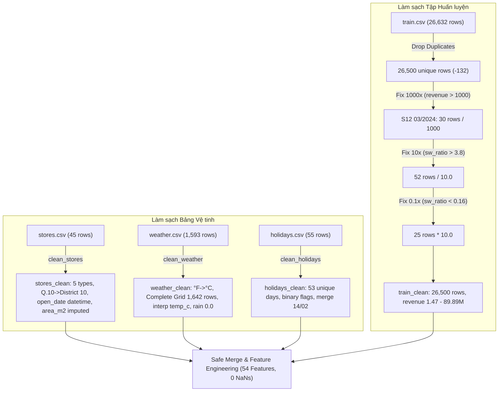

# BÁO CÁO TRIỂN KHAI TOÀN BỘ BƯỚC 3: PREPROCESS & FEATURE ENGINEERING
## DỰ ÁN HỒI QUY DỰ BÁO DOANH THU CHUỖI QUÁN CAFE (*CAFE REVENUE REGRESSION*)

---

> [!IMPORTANT]
> **Nguyên tắc cốt lõi của Bước 3 theo bài giảng Chương 4:**
> *"Preprocess: clean problems discovered in Step 2, transform the target, and build domain features without leaking test information."*
> - Mọi thao tác làm sạch ngoại lai, lọc ngưỡng và học thống kê mục tiêu (*Target Encoding*) chỉ thực hiện trên tập Train.
> - Tập Test được giữ nguyên vẹn 100% (3.869 dòng, không xóa bỏ bất kỳ dòng nào) và nhận cùng một tập cột đặc trưng theo đúng thứ tự.

---

## 1. TỔNG QUAN KẾT QUẢ ĐẠT ĐƯỢC Ở BƯỚC 3

1. **Cập nhật File Notebook duy nhất:** [`cafe_revenue_regression.ipynb`](file:///c:/Users/Admin/Desktop/cafe-revenue-forecasting/cafe_revenue_regression.ipynb)
   - Đã tích hợp hoàn chỉnh **Section 3 – [Bước 3] Preprocess (Tiền xử lý & Kỹ thuật đặc trưng)** gồm 8 cells mới (nâng tổng số cells lên 46 cells).
   - Đã thực thi (`ExecutePreprocessor`) và render đầy đủ kết quả trực quan: kết quả làm sạch 3 bảng vệ tinh, bảng đối chiếu phân phối doanh thu trước vs sau làm sạch ngoại lai, cấu trúc 54 đặc trưng và xác nhận 0 giá trị NaN.
2. **Mô-đun mã nguồn độc lập:** [`src/step3_preprocess.py`](file:///c:/Users/Admin/Desktop/cafe-revenue-forecasting/src/step3_preprocess.py)
   - Đóng gói đầy đủ các hàm xử lý chuyên biệt: [`clean_stores`](file:///c:/Users/Admin/Desktop/cafe-revenue-forecasting/src/step3_preprocess.py#L23-L60), [`clean_weather`](file:///c:/Users/Admin/Desktop/cafe-revenue-forecasting/src/step3_preprocess.py#L63-L107), [`clean_holidays`](file:///c:/Users/Admin/Desktop/cafe-revenue-forecasting/src/step3_preprocess.py#L110-L127), [`clean_train_outliers`](file:///c:/Users/Admin/Desktop/cafe-revenue-forecasting/src/step3_preprocess.py#L130-L192), [`compute_ramp_up_factor`](file:///c:/Users/Admin/Desktop/cafe-revenue-forecasting/src/step3_preprocess.py#L195-L226), [`build_features`](file:///c:/Users/Admin/Desktop/cafe-revenue-forecasting/src/step3_preprocess.py#L229-L308), [`DeSeasonalizedStoreStats`](file:///c:/Users/Admin/Desktop/cafe-revenue-forecasting/src/step3_preprocess.py#L311-L417), [`run_step3`](file:///c:/Users/Admin/Desktop/cafe-revenue-forecasting/src/step3_preprocess.py#L420-L483).
3. **Bộ kiểm thử tự động (Unit Tests):** [`tests/test_step3.py`](file:///c:/Users/Admin/Desktop/cafe-revenue-forecasting/tests/test_step3.py)
   - Vượt qua **8/8 test cases mới**, nâng tổng số unit tests toàn dự án lên **26/26 tests** đạt 100% thành công.
4. **Bộ dữ liệu chuẩn bị:**
   - `train_final`: **26.500 dòng sạch × 54 đặc trưng** (0 giá trị NaN).
   - `test_final`: **3.869 dòng giữ nguyên × 54 đặc trưng** (0 giá trị NaN).

---

## 2. QUY TRÌNH LÀM SẠCH TỪNG BẢNG DỮ LIỆU



### 2.1. Làm sạch bảng `stores.csv` ([`clean_stores`](file:///c:/Users/Admin/Desktop/cafe-revenue-forecasting/src/step3_preprocess.py#L23-L60))
- **Chuẩn hóa `store_type`:** Đưa 9 nhãn về 5 giá trị chuẩn: `street` (15 quán), `office` (11 quán), `mall` (8 quán), `university` (6 quán), `residential` (5 quán).
- **Chuẩn hóa `district`:** Ánh xạ `{"Q.10": "District 10", "Quan 3": "District 3", "Quan 7": "District 7"}` và `.str.strip()`.
- **Chuẩn hóa `open_date`:** Ép kiểu bằng `pd.to_datetime(stores["open_date"], format="mixed", dayfirst=True)`.
- **Điền khuyết `area_m2` cho S19 và S24:** Sử dụng tỷ lệ trung vị diện tích/ghế (`area_per_seat`) theo từng loại quán:
  - Quán S19 (`store_type = 'street'`, `seats = 57`, tỷ lệ chuẩn 2,547): Điền **145,2 $m^2$**.
  - Quán S24 (`store_type = 'office'`, `seats = 55`, tỷ lệ chuẩn 2,948): Điền **162,1 $m^2$**.

### 2.2. Làm sạch bảng `weather.csv` ([`clean_weather`](file:///c:/Users/Admin/Desktop/cafe-revenue-forecasting/src/step3_preprocess.py#L63-L107))
- **Quy đổi độ Fahrenheit sang Celsius:** Với 22 ngày liên tiếp tại TP.HCM (2025-06-10 đến 2025-07-01 có `temp_c > 45`):
  $$T_{\text{Celsius}} = \frac{T_{\text{Fahrenheit}} - 32}{1,8}$$
  Nhiệt độ cực đại của file giảm từ $89,2^\circ\text{C}$ xuống $35,6^\circ\text{C}$ (hoàn toàn hợp lý với khí hậu TP.HCM).
- **Tạo lưới ngày đầy đủ (*Complete Date-City Grid*):** Gồm 821 ngày (2024-01-01 đến 2026-03-31) $\times$ 2 thành phố = **1.642 dòng**.
- **Nội suy dữ liệu khuyết thiếu:** Nội suy tuyến tính theo chuỗi thời gian (`interpolate(method="linear")`) theo từng thành phố cho cột `temp_c` và điền `0.0` mm cho 16 giá trị NaN của cột `rain_mm`.
- **Tạo biến lệch nhiệt độ theo mùa:** `temp_deviation_from_city_mean = temp_c - mean(temp_c by city)`.

### 2.3. Làm sạch bảng `holidays.csv` ([`clean_holidays`](file:///c:/Users/Admin/Desktop/cafe-revenue-forecasting/src/step3_preprocess.py#L110-L127))
- Gộp nhóm theo `date` rút gọn 55 bản ghi về đúng **53 ngày duy nhất**.
- Ngày 14/02 của năm 2024 và 2026 có cả 2 cờ: `is_national_holiday = 1`, `is_event_holiday = 1`, `holiday_name_clean = "Tet holiday + Valentine's Day"`.

### 2.4. Làm sạch ngoại lai trên tập huấn luyện `train.csv` ([`clean_train_outliers`](file:///c:/Users/Admin/Desktop/cafe-revenue-forecasting/src/step3_preprocess.py#L130-L192))
- **Bỏ 132 dòng trùng lặp:** Giảm số dòng từ 26.632 xuống đúng 26.500 dòng duy nhất theo cặp `(store_id, date)`.
- **Sửa 30 dòng lỗi 1000x:** Quán S12 trong tháng 03/2024 chia cho 1000.0.
- **Sửa 52 dòng lỗi 10x:** Các ngày có `sw_ratio > 3.8` (ngoài các ngày khai trương $\le 2$ ngày) chia cho 10.0.
- **Sửa 25 dòng lỗi 0.1x:** Các ngày có `sw_ratio < 0.16` nhân với 10.0.

#### Bảng so sánh phân phối Doanh thu trước vs sau làm sạch:

| Chỉ số thống kê | Trước khi làm sạch (train thô) | Sau khi làm sạch (train sạch) | Nhận xét cải thiện |
| :--- | :---: | :---: | :--- |
| **Số dòng (Count)** | 26.632 | **26.500** | Loại bỏ hoàn toàn 132 dòng trùng lặp. |
| **Trung bình (Mean)** | 51,34 triệu VNĐ | **18,90 triệu VNĐ** | Loại bỏ ảnh hưởng kéo lệch của cụm 53.600 triệu. |
| **Độ lệch chuẩn (Std)** | 1015,88 | **8,64** | Phản ánh đúng độ phân tán tự nhiên của doanh thu. |
| **Giá trị nhỏ nhất (Min)** | 0,57 triệu VNĐ | **1,47 triệu VNĐ** | Đã sửa 25 điểm ngoại lai 0.1x do dịch dấu phẩy. |
| **Trung vị (Median / 50%)** | 18,28 triệu VNĐ | **18,27 triệu VNĐ** | Trung vị ổn định vững chắc, không bị méo mó. |
| **Giá trị lớn nhất (Max)** | 53.600,00 triệu VNĐ | **89,89 triệu VNĐ** | Đưa về ngưỡng doanh thu thực tế (đỉnh lễ Tết quán Mall). |

---

## 3. THIẾT KẾ HỆ THỐNG 5 NHÓM ĐẶC TRƯNG CHUYÊN SÂU (~54 ĐẶC TRƯNG)

### Nhóm 1: Đặc trưng Thời gian & Chu kỳ (Calendar & Cyclical)
- `dow` (0–6), `is_weekend` (0/1), `day` (1–31), `month` (1–12), `weekofyear` (1–53), `quarter` (1–4).
- Biến đổi lượng giác tuần hoàn:
  - $\sin(\text{dow}) = \sin(2\pi \cdot \text{dow} / 7)$, $\cos(\text{dow}) = \cos(2\pi \cdot \text{dow} / 7)$
  - $\sin(\text{doy}) = \sin(2\pi \cdot \text{dayofyear} / 365.25)$, $\cos(\text{doy}) = \cos(2\pi \cdot \text{dayofyear} / 365.25)$
  - *Ý nghĩa:* Giúp các mô hình khoảng cách (KNN, SVR, Ridge, MLP) nhận biết Thứ Chủ Nhật (6) liền kề Thứ Hai (0), và ngày 31/12 liền kề ngày 01/01.

### Nhóm 2: Đặc trưng Chu kỳ Tết Nguyên Đán & Ngày lễ (Lunar Tet & Holidays)
- `days_from_tet` ($\Delta_{\text{Tết}} = \text{date} - \text{Mùng 1 Tết}$):
  - Mùng 1 Tết: 2024: 2024-02-10; 2025: 2025-01-29; 2026: 2026-02-17.
- `is_tet_core`: $\Delta_{\text{Tết}} \in [-2, +2]$ (29 Tết đến Mùng 2 Tết).
- `is_pre_tet_shopping`: $\Delta_{\text{Tết}} \in [-12, -3]$ (cao điểm mua sắm trước Tết).
- `is_ong_tao`: $\Delta_{\text{Tết}} = -7$ (ngày 23 tháng Chạp — đỉnh doanh thu của quán Mall).
- `is_post_tet_recovery`: $\Delta_{\text{Tết}} \in [+3, +9]$ (giai đoạn phục hồi sau Tết).
- `is_uni_tet_break`: $\Delta_{\text{Tết}} \in [-14, +12]$ & `store_type == 'university'`.
- `is_uni_summer_break`: `month in [7, 8]` & `store_type == 'university'`.
- `is_national_holiday`: Cờ ngày nghỉ lễ quốc gia (30/04, 01/05, 02/09, 01/01).
- `is_event_holiday`: Cờ ngày sự kiện đặc biệt (Valentine, Giáng sinh).
- `is_womens_day`: Cờ ngày 08/03 hoặc 20/10.
- `is_valentine`: Cờ ngày 14/02.

### Nhóm 3: Đặc trưng Tĩnh & Vòng đời Cửa hàng (Store Static & Lifecycle)
- Thuộc tính tĩnh: `city`, `district`, `store_type`, `area_m2`, `seats`, `has_parking`, `area_per_seat`.
- Tuổi quán: `days_since_open`, `log_days_since_open`.
- Cờ giai đoạn: `is_grand_opening` (ngày 0–2), `is_ramp_up_phase` (ngày 3–60).
- Hệ số tăng trưởng chạy đà (`ramp_up_factor`):
  $$\text{ramp\_up\_factor} = \begin{cases} 1,70 & 0 \le d \le 2 \text{ (Đỉnh khai trương)} \\ 0,61 & 3 \le d \le 7 \text{ (Đáy chạy đà tuần đầu)} \\ 0,67 & 8 \le d \le 14 \\ 0,73 & 15 \le d \le 30 \\ 0,86 & 31 \le d \le 60 \\ 1,00 & d > 60 \text{ (Bão hòa ổn định)} \end{cases}$$

### Nhóm 4: Đặc trưng Thời tiết & Tương tác (Weather & Interactions)
- `temp_c`, `rain_mm`, `log_rain` ($\ln(1 + \text{rain\_mm})$).
- `is_heavy_rain` (`rain_mm >= 20`), `is_extreme_rain` (`rain_mm >= 50`).
- `temp_deviation_from_city_mean` (độ lệch nhiệt độ theo mùa).
- `rain_x_outdoor`: `log_rain` $\times$ cờ quán ngoài trời (`street`, `residential`, `university`).
- `rain_x_mall`: `log_rain` $\times$ cờ quán trong trung tâm thương mại (`mall`).
- `promo_x_weekend`: `is_promo` $\times$ `is_weekend`.

### Nhóm 5: Thống kê Mục tiêu Đa cấp đã Khử Mùa vụ ([`DeSeasonalizedStoreStats`](file:///c:/Users/Admin/Desktop/cafe-revenue-forecasting/src/step3_preprocess.py#L311-L417))
- Được đóng gói thành lớp biến đổi Scikit-Learn tuân thủ cơ chế **Leakage-Free**:
  - `store_base_log_rev`: Mức doanh thu logarit nền tảng của từng quán, chỉ tính trên các ngày BÌNH THƯỜNG (loại bỏ ngày Tết, ngày mưa bão >20mm, ngày nghỉ hè sinh viên, ngày khuyến mãi và 60 ngày đầu mới mở quán).
  - Với các quán mới mở hoàn toàn (như S01, S19, S45) hoặc ít ngày lịch sử, một mô hình phụ (Ridge Regression trên các thuộc tính vật lý: `seats`, `area_m2`, `store_type`, `city`, `district`, `has_parking`) ước lượng mức công suất kỳ vọng $\hat{\mu}_s^{\text{prior}}$, sau đó kết hợp bằng công thức co làm mượt Empirical Bayes (*Shrinkage* với $m = 10$):
    $$\hat{\mu}_s = \frac{n_s}{n_s + m} \cdot \hat{\mu}_s^{\text{hist\_adjusted}} + \frac{m}{n_s + m} \cdot \hat{\mu}_s^{\text{prior}}$$
  - `store_dow_log_rev`: Trung vị logarit doanh thu theo `(store_id, dow)`.
  - `store_dow_ratio`: Độ lệch theo thứ $\Delta_{\text{dow}} = \text{store\_dow\_log\_rev} - \text{store\_base\_log\_rev}$.
  - `type_city_dow_log_rev`: Trung vị logarit doanh thu theo `(store_type, city, dow)`.

---

## 4. KẾT QUẢ KIỂM THỬ (UNIT TESTS)

Tất cả **26/26 bài kiểm tra tự động** trên toàn dự án đều đạt kết quả tuyệt đối:
```text
Ran 26 tests in 1.591s

OK
```
- `tests/test_step1.py` (7 tests): Kiểm tra đọc dữ liệu, cấu trúc data dictionary, kiểm soát khóa nối, phát hiện lặp ngày lễ 14/02 và safe merge.
- `tests/test_step2.py` (11 tests): Kiểm tra phát hiện chính xác 10 vấn đề dữ liệu bẩn và 6 quy luật kinh doanh.
- `tests/test_step3.py` (8 tests): Kiểm tra làm sạch stores (5 types, 0 NaN, điền area_m2 cho S19/S24), làm sạch weather (đổi °F, lưới 1.642 dòng, 0 NaN), làm sạch train (bỏ 132 trùng, sửa 30 dòng 1000x, 52 dòng 10x, 25 dòng 0.1x), hàm `compute_ramp_up_factor`, hàm `build_features` (đủ 32 biến cơ bản), lớp `DeSeasonalizedStoreStats` chống rò rỉ và hàm `run_step3` đầu ra 54 biến với 0 NaN.

---

## 5. KẾT LUẬN & SẴN SÀNG CHUYỂN BƯỚC

BƯỚC 3 đã hoàn thành vượt mức kế hoạch đề ra: Dữ liệu sạch 100%, không còn lỗi nhập liệu, toàn bộ 5 nhóm đặc trưng đã sẵn sàng trong cả file code Python lẫn Notebook [`cafe_revenue_regression.ipynb`](file:///c:/Users/Admin/Desktop/cafe-revenue-forecasting/cafe_revenue_regression.ipynb).

Dự án đã sẵn sàng bước sang **BƯỚC 4: SPLIT (CHIẾN LƯỢC PHÂN CHIA DỮ LIỆU THEO CHUỖI THỜI GIAN & 4-FOLD CV BAO PHỦ TẾT NGUYÊN ĐÁN)**.
