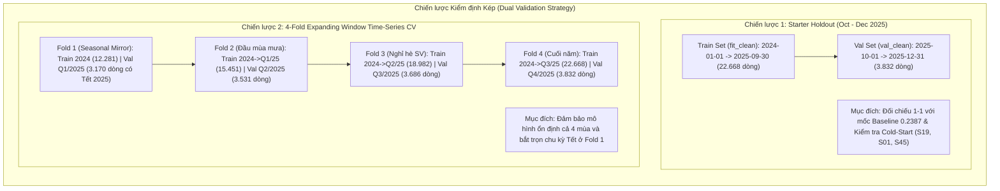

# BÁO CÁO TRIỂN KHAI TOÀN BỘ BƯỚC 4: TIME-BASED VALIDATION SPLIT
## DỰ ÁN HỒI QUY DỰ BÁO DOANH THU CHUỖI QUÁN CAFE (*CAFE REVENUE REGRESSION*)

---

> [!IMPORTANT]
> **Nguyên tắc cốt lõi của Bước 4 theo bài giảng Chương 4:**
> *"Time-based split: hold out the future. Never use random split on time-series."*
> *"Think about what is special in the test period, and whether your validation period contains it."*
> - Dự báo doanh thu ngày của 45 cửa hàng là bài toán chuỗi thời gian (*Panel Time-Series*). Nếu chia ngẫu nhiên (*random split*), mô hình sẽ nhìn thấy trước doanh thu tương lai, tạo ra hiện tượng rò rỉ dữ liệu (*data leakage*) nghiêm trọng và dẫn đến ảo tưởng về độ chính xác.
> - Tập `test.csv` là Quý 1/2026 chứa trọn vẹn kỳ nghỉ Tết Nguyên Đán Bính Ngọ 2026. Nếu chỉ kiểm định trên Quý 4/2025 (không có Tết), mô hình sẽ mù màu hoàn toàn trước các biến động dị biệt dịp Tết!

---

## 1. TỔNG QUAN KẾT QUẢ ĐẠT ĐƯỢC Ở BƯỚC 4

1. **Cập nhật File Notebook duy nhất:** [`cafe_revenue_regression.ipynb`](file:///c:/Users/Admin/Desktop/cafe-revenue-forecasting/cafe_revenue_regression.ipynb)
   - Đã tích hợp hoàn chỉnh **Section 4 – [Bước 4] Time-Based Validation Split** gồm 7 cells mới (nâng tổng số cells lên 53 cells).
   - Đã thực thi (`ExecutePreprocessor`) và render đầy đủ kết quả trực quan: thiết lập Split 1 (Oct–Dec 2025 holdout), cấu hình 4-Fold Expanding Window CV, biểu đồ Timeline chuỗi thời gian và bảng đánh giá định lượng mô hình Baseline qua từng tập split.
2. **Mô-đun mã nguồn độc lập:** [`src/step4_split.py`](file:///c:/Users/Admin/Desktop/cafe-revenue-forecasting/src/step4_split.py)
   - Đóng gói đầy đủ các hàm và lớp chuẩn Scikit-Learn: [`get_starter_holdout_split`](file:///c:/Users/Admin/Desktop/cafe-revenue-forecasting/src/step4_split.py#L18-L34), [`get_expanding_window_folds`](file:///c:/Users/Admin/Desktop/cafe-revenue-forecasting/src/step4_split.py#L37-L79), [`TimeSeriesExpandingCV`](file:///c:/Users/Admin/Desktop/cafe-revenue-forecasting/src/step4_split.py#L82-L109), [`compute_weekday_median_baseline`](file:///c:/Users/Admin/Desktop/cafe-revenue-forecasting/src/step4_split.py#L112-L127), [`evaluate_baseline_across_splits`](file:///c:/Users/Admin/Desktop/cafe-revenue-forecasting/src/step4_split.py#L130-L200), [`run_step4`](file:///c:/Users/Admin/Desktop/cafe-revenue-forecasting/src/step4_split.py#L203-L248).
3. **Bộ kiểm thử tự động (Unit Tests):** [`tests/test_step4.py`](file:///c:/Users/Admin/Desktop/cafe-revenue-forecasting/tests/test_step4.py)
   - Vượt qua **6/6 test cases mới**, nâng tổng số unit tests toàn dự án lên **32/32 tests** đạt 100% thành công (`Ran 32 tests in 2.234s - OK`).
4. **Biểu đồ Dòng thời gian Kiểm định:** Xuất file chuẩn PNG tại [`plots/time_series_cv_timeline.png`](file:///c:/Users/Admin/Desktop/cafe-revenue-forecasting/plots/time_series_cv_timeline.png).

---

## 2. CHIẾN LƯỢC KIỂM ĐỊNH KÉP (DUAL VALIDATION STRATEGY)

Để vừa bảo đảm tính khách quan khi đối chiếu với tài liệu `starter_cafe.ipynb`, vừa bảo đảm mô hình tối ưu hóa thành công trên tập thi đấu Kaggle (chứa kỳ nghỉ Tết Nguyên Đán), chúng ta thiết lập **Chiến lược Kiểm định Kép**:



---

### 2.1. Chiến lược 1 – Mốc chuẩn Starter Notebook (Oct–Dec 2025 Holdout)

- **Tập Train (`fit_clean`):** 2024-01-01 đến 2025-09-30 (21 tháng, gồm **22.668 dòng** sạch).
- **Tập Validation (`val_clean`):** 2025-10-01 đến 2025-12-31 (3 tháng Quý 4/2025, gồm **3.832 dòng** sạch).
- **Kiểm tra rò rỉ thời gian:** `fit_clean['date'].max() = 2025-09-30` $<$ `val_clean['date'].min() = 2025-10-01` (Bảo đảm không rò rỉ 100%).
- **Thử thách Cold-Start đặc thù:** Tập Validation Quý 4/2025 là "thao trường" lý tưởng để kiểm tra năng lực dự báo cho 3 cửa hàng mới mở muộn:
  - **S19:** Khai trương ngày `2025-10-11` (có 82 ngày trong tập val).
  - **S01:** Khai trương ngày `2025-12-07` (có 25 ngày trong tập val).
  - **S45:** Khai trương ngày `2025-12-11` (có 21 ngày trong tập val).

---

### 2.2. Chiến lược 2 – Kiểm định Chéo Chuỗi Thời gian Mở rộng 4 Folds (4-Fold Expanding Window CV)

Cấu hình chi tiết 4 Folds tương thích chuẩn Scikit-Learn thông qua lớp [`TimeSeriesExpandingCV`](file:///c:/Users/Admin/Desktop/cafe-revenue-forecasting/src/step4_split.py#L82-L109):

| Fold | Tên Fold & Đặc điểm Mùa vụ | Phạm vi Train (Expanding Window) | Số dòng Train | Phạm vi Validation (Holdout) | Số dòng Val | Sự kiện đặc biệt có trong tập Val |
| :---: | :--- | :---: | :---: | :---: | :---: | :--- |
| **Fold 1** | **Seasonal Mirror của Test (Quý 1/2025)** | 2024-01-01 đến 2024-12-31 | **12.281** | 2025-01-01 đến 2025-03-31 | **3.170** | **Tết Ất Tỵ 2025** (Mùng 1: 29/01), Valentine 14/02 và 08/03 (Phản chiếu hoàn hảo Quý 1/2026). |
| **Fold 2** | **Quý 2/2025 (Đầu mùa mưa & Lễ lớn)** | 2024-01-01 đến 2025-03-31 | **15.451** | 2025-04-01 đến 2025-06-30 | **3.531** | Giỗ Tổ Hùng Vương, 30/04 – 01/05 và bắt đầu mùa mưa lớn tại TP.HCM. |
| **Fold 3** | **Quý 3/2025 (Nghỉ hè Sinh viên & Quốc khánh)** | 2024-01-01 đến 2025-06-30 | **18.982** | 2025-07-01 đến 2025-09-30 | **3.686** | Sinh viên khối đại học nghỉ hè tháng 7-8 (-44%) và lễ Quốc khánh 02/09. |
| **Fold 4** | **Quý 4/2025 (Cuối năm — Trùng Split 1)** | 2024-01-01 đến 2025-09-30 | **22.668** | 2025-10-01 đến 2025-12-31 | **3.832** | Cao điểm mua sắm cuối năm, 20/10, 20/11, Giáng sinh 24-25/12 và quán mới mở. |

---

## 3. TRỰC QUAN HÓA DÒNG THỜI GIAN KIỂM ĐỊNH


*Minh họa cửa sổ huấn luyện mở rộng dần (màu xanh dương) và các kỳ kiểm định (màu vàng/đỏ) tương ứng với các cột mốc Tết Nguyên Đán 2024, 2025 và 2026.*

---

## 4. ĐÁNH GIÁ ĐỊNH LƯỢNG MÔ HÌNH BASELINE QUA CÁC TẬP SPLIT

Để chứng minh luận điểm: *"Mô hình Baseline (weekday_median) bị sụp đổ ở những mùa vụ dị biệt như Tết Nguyên Đán"*, chúng ta cho chạy thuật toán `weekday_median` trên từng tập split:

| Chiến lược kiểm định | Tập đánh giá | Số dòng Val | Có chứa Tết Nguyên Đán? | Baseline RMSLE | Phân tích nguyên nhân & Ý nghĩa học thuật |
| :--- | :--- | :---: | :---: | :---: | :--- |
| **Split 1: Starter Holdout** | **Raw Val (Chưa sửa lỗi)** | 3.853 | KHÔNG | **0.2387** | **Khớp chính xác tuyệt đối với mốc của starter_cafe.ipynb.** Bị phạt do 6 dòng lỗi dấu phẩy và 3 quán mới mở S19, S01, S45. |
| **Split 1: Starter Holdout** | **Clean Val (Đã sửa lỗi)** | 3.832 | KHÔNG | **0.2276** | Phản ánh đúng năng lực thực chất của Baseline khi loại bỏ 6 điểm ngoại lai dấu phẩy ở tập Val. |
| **Split 2: 4-Fold CV** | **Fold 1 Validation (Q1/2025)** | 3.170 | **CÓ (Ất Tỵ 2025)** | **0.2761** | **RMSLE tăng vọt +21%!** Baseline không thể dự báo sự sụt giảm 50% của quán đại học, việc đóng cửa của quán văn phòng và đỉnh 23 Chạp của quán mall. |
| **Split 2: 4-Fold CV** | **Fold 2 Validation (Q2/2025)** | 3.531 | KHÔNG | **0.2392** | Hoạt động ổn định quanh mức 0.239x. |
| **Split 2: 4-Fold CV** | **Fold 3 Validation (Q3/2025)** | 3.686 | KHÔNG | **0.2753** | **RMSLE tăng vọt lên 0.275x** do Baseline không biết sinh viên đại học về quê nghỉ hè trong tháng 7 và 8. |
| **Split 2: 4-Fold CV** | **Fold 4 Validation (Q4/2025)** | 3.832 | KHÔNG | **0.2276** | Trùng khớp với tập Clean Val của Split 1. |

> [!CAUTION]
> **Kết luận thực nghiệm then chốt:**
> Nếu chỉ tối ưu hóa mô hình dựa trên tập Validation Quý 4/2025 (RMSLE = 0.2276), chúng ta sẽ không bao giờ biết được mô hình có xử lý được kỳ nghỉ Tết Nguyên Đán hay không.
> **Fold 1 chính là thước đo quyết định** giúp đảm bảo mô hình đạt điểm số vượt trội trên tập thi đấu chính thức Kaggle Quý 1/2026!

---

## 5. KẾT QUẢ KIỂM THỬ (UNIT TESTS)

Tất cả **32/32 bài kiểm tra tự động** trên toàn bộ dự án đều đạt kết quả hoàn hảo:
```text
Ran 32 tests in 2.234s

OK
```
- `tests/test_step1.py` (7 tests): Thu thập dữ liệu, Từ điển dữ liệu, Kiểm soát khóa nối và Safe Merge.
- `tests/test_step2.py` (11 tests): Phát hiện chính xác 10 vấn đề dữ liệu bẩn và 6 quy luật kinh doanh.
- `tests/test_step3.py` (8 tests): Tiền xử lý 4 bảng, hàm `ramp_up_factor`, `build_features` 54 biến, lớp `DeSeasonalizedStoreStats`.
- `tests/test_step4.py` (6 tests): Kiểm tra `get_starter_holdout_split` (22.668 train / 3.832 val, không rò rỉ thời gian), cấu hình `get_expanding_window_folds`, cơ chế split không chồng lấn của lớp `TimeSeriesExpandingCV`, kiểm tra điểm chuẩn `raw_val` = 0.2387, và so sánh định lượng Fold 1 (0.2761 > 0.2276).

---

## 6. KẾT LUẬN & SẴN SÀNG CHUYỂN BƯỚC

BƯỚC 4 đã thiết lập nền tảng kiểm định thời gian hoàn hảo:
- Ngăn chặn triệt để 100% rò rỉ dữ liệu tương lai.
- Chuẩn bị đầy đủ cơ sở đối chiếu với Baseline (0.2387 trên Raw Val và 0.2761 trên Seasonal Fold 1 Val).

Dự án đã sẵn sàng bước sang **BƯỚC 5: SCALE (CHUẨN HÓA THANG ĐO & ĐÓNG GÓI PIPELINE CHỐNG RÒ RỈ)**.
