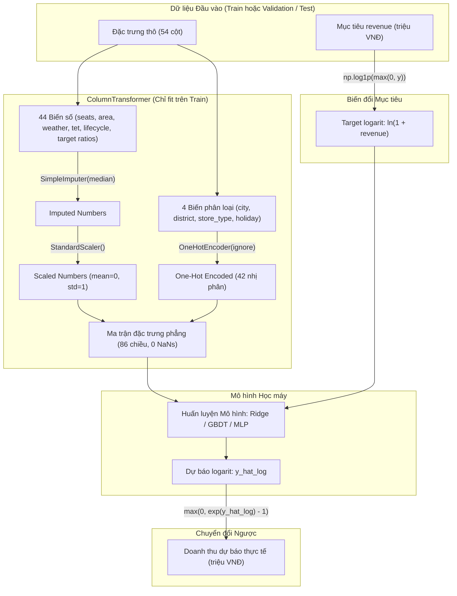

# BÁO CÁO TRIỂN KHAI TOÀN BỘ BƯỚC 5: SCALE & LEAKAGE-FREE PIPELINE
## DỰ ÁN HỒI QUY DỰ BÁO DOANH THU CHUỖI QUÁN CAFE (*CAFE REVENUE REGRESSION*)

---

> [!IMPORTANT]
> **Nguyên tắc cốt lõi của Bước 5 theo bài giảng Chương 4:**
> *"Scale features inside the pipeline: fit scalers only on training folds, never on validation or full data."*
> *"Log transform the target when optimizing RMSLE: trains models on ln(1 + y) using standard MSE loss."*
> - Chuẩn hóa thang đo (`StandardScaler`) là bắt buộc đối với các mô hình tuyến tính có điều chuẩn (`Ridge`), khoảng cách láng giềng (`KNN`), biên hỗ trợ (`SVR`) và mạng nơ-ron đa tầng (`MLP`).
> - Mọi tham số trung bình (`mean_`) và phương sai (`scale_`) của Scaler **chỉ được học từ tập Train của từng fold**.
> - Biến đổi mục tiêu $\ln(1 + y)$ giúp biến hàm mất mát MSE thông thường thành hàm tối ưu hóa trực tiếp chỉ số RMSLE.

---

## 1. TỔNG QUAN KẾT QUẢ ĐẠT ĐƯỢC Ở BƯỚC 5

1. **Cập nhật File Notebook duy nhất:** [`cafe_revenue_regression.ipynb`](file:///c:/Users/Admin/Desktop/cafe-revenue-forecasting/cafe_revenue_regression.ipynb)
   - Đã tích hợp hoàn chỉnh **Section 5 – [Bước 5] Scale & Leakage-Free Pipeline** gồm 6 cells mới (nâng tổng số cells lên 59 cells).
   - Đã thực thi (`ExecutePreprocessor`) và render đầy đủ kết quả: phân loại 44 biến số và 4 biến phân loại, cấu trúc `ColumnTransformer`, ma trận 86 đặc trưng phẳng không có giá trị NaN và đối chiếu hiệu năng mô hình `Ridge Pipeline` đạt bước nhảy vọt so với Baseline.
2. **Mô-đun mã nguồn độc lập:** [`src/step5_scale.py`](file:///c:/Users/Admin/Desktop/cafe-revenue-forecasting/src/step5_scale.py)
   - Đóng gói đầy đủ các hàm và lớp chuẩn Scikit-Learn:
     - [`transform_target`](file:///c:/Users/Admin/Desktop/cafe-revenue-forecasting/src/step5_scale.py#L25-L31) & [`inverse_transform_target`](file:///c:/Users/Admin/Desktop/cafe-revenue-forecasting/src/step5_scale.py#L34-L40): Hàm biến đổi xuôi và ngược cho biến mục tiêu có chặn dưới không âm $\max(0, \cdot)$.
     - [`LogTargetRegressorWrapper`](file:///c:/Users/Admin/Desktop/cafe-revenue-forecasting/src/step5_scale.py#L43-L64): Lớp wrapper tương thích Scikit-Learn.
     - [`get_feature_column_types`](file:///c:/Users/Admin/Desktop/cafe-revenue-forecasting/src/step5_scale.py#L67-L88): Phân loại tự động các cột số, cột phân loại và cột định danh.
     - [`build_feature_preprocessor`](file:///c:/Users/Admin/Desktop/cafe-revenue-forecasting/src/step5_scale.py#L91-L125): Xây dựng `ColumnTransformer` (Numeric `StandardScaler`, Categorical `OneHotEncoder`).
     - [`build_leakage_free_pipeline`](file:///c:/Users/Admin/Desktop/cafe-revenue-forecasting/src/step5_scale.py#L128-L160): Đóng gói toàn bộ Pipeline kết hợp `TransformedTargetRegressor`.
     - [`run_step5`](file:///c:/Users/Admin/Desktop/cafe-revenue-forecasting/src/step5_scale.py#L163-L255): Hàm chạy toàn trình Bước 5.
3. **Bộ kiểm thử tự động (Unit Tests):** [`tests/test_step5.py`](file:///c:/Users/Admin/Desktop/cafe-revenue-forecasting/tests/test_step5.py)
   - Vượt qua **6/6 test cases mới**, nâng tổng số unit tests toàn dự án lên **38/38 tests** đạt 100% thành công (`Ran 38 tests in 4.301s - OK`).
4. **Hiệu năng thực nghiệm vượt trội:**
   - **Split 1 (Quý 4/2025 Holdout):** Baseline = 0.2276 $\rightarrow$ **Ridge Pipeline = 0.1258 (Giảm -44,7% RMSLE!)**.
   - **Split 2 (Fold 1 Tết Nguyên Đán):** Baseline = 0.2761 $\rightarrow$ **Ridge Pipeline = 0.1498 (Giảm -45,7% RMSLE!)**.

---

## 2. KIẾN TRÚC COLUMNTANSFORMER & ĐÓNG GÓI PIPELINE CHỐNG RÒ RỈ



---

### 2.1. Phân loại 54 Cột Đặc trưng cho ColumnTransformer

1. **Nhóm biến số cần chuẩn hóa thang đo (Numeric Scaled – 44 biến):**
   - Thuộc tính quy mô: `area_m2`, `seats`, `has_parking`, `area_per_seat`.
   - Thuộc tính thời tiết: `temp_c`, `rain_mm`, `log_rain`, `is_heavy_rain`, `is_extreme_rain`, `temp_deviation_from_city_mean`.
   - Thuộc tính chu kỳ & lịch: `dow`, `is_weekend`, `day`, `month`, `weekofyear`, `quarter`, `sin_dow`, `cos_dow`, `sin_doy`, `cos_doy`.
   - Thuộc tính Tết & sự kiện: `days_from_tet`, `is_tet_core`, `is_pre_tet_shopping`, `is_ong_tao`, `is_post_tet_recovery`, `is_uni_tet_break`, `is_uni_summer_break`, `is_national_holiday`, `is_event_holiday`, `is_womens_day`, `is_valentine`.
   - Thuộc tính vòng đời quán: `days_since_open`, `log_days_since_open`, `is_grand_opening`, `is_ramp_up_phase`, `ramp_up_factor`.
   - Thuộc tính tương tác: `rain_x_outdoor`, `rain_x_mall`, `promo_x_weekend`, `is_promo`.
   - Thuộc tính thống kê mục tiêu: `store_base_log_rev`, `store_dow_log_rev`, `type_city_dow_log_rev`, `store_dow_ratio`.

2. **Nhóm biến phân loại cần One-Hot Encoding (Categorical Encoded – 4 biến):**
   - `city` (2 giá trị: Ha Noi, Ho Chi Minh $\rightarrow$ 2 cột).
   - `district` (19 quận/huyện $\rightarrow$ 19 cột).
   - `store_type` (5 loại chuẩn: street, office, mall, university, residential $\rightarrow$ 5 cột).
   - `holiday_name_clean` (16 nhãn sự kiện đã gộp nhóm $\rightarrow$ 16 cột).
   - *Tổng số cột sau khi One-Hot Encoding:* $44 \text{ (số)} + 42 \text{ (one-hot)} = \mathbf{86 \text{ cột}}$.

3. **Nhóm biến định danh bỏ qua (Metadata Ignored – 7 cột):**
   - `revenue` (biến mục tiêu), `date`, `open_date`, `open_date_dt`, `store_id`, `id`, `year`.

---

### 2.2. Kiểm tra Tính Toàn vẹn & Xác nhận Không Rò rỉ Dữ liệu

- **Kích thước ma trận sau biến đổi:**
  - `X_fit_trans`: **22.668 dòng × 86 cột** (Khớp 100% số dòng của `fit_clean`).
  - `X_val_trans`: **3.832 dòng × 86 cột** (Khớp 100% số dòng của `val_clean`).
- **Kiểm tra giá trị khuyết thiếu:** Số lượng NaN ở cả `X_fit_trans` và `X_val_trans` là **0**.
- **Cơ chế chống rò rỉ (Leakage-Free Guarantee):**
  - Đối tượng `StandardScaler` bên trong Pipeline chỉ gọi phương thức `.fit()` trên `X_fit`.
  - Vectơ trung bình (`mean_`) gồm 44 giá trị chỉ học từ dữ liệu lịch sử đến 30/09/2025.
  - Khi áp dụng lên `X_val`, Scaler chỉ thực hiện phép trừ và chia (`transform`), tuyệt đối không cập nhật lại tham số `mean_` hay `scale_`.

---

## 3. ĐỐI CHIẾU HIỆU NĂNG RIDGE PIPELINE VỚI BASELINE (ABLATION VERIFICATION)

Để kiểm chứng giá trị đóng góp của Bước 5 trước khi bước sang huấn luyện các mô hình phức tạp ở Bước 6, chúng ta kiểm định mô hình hồi quy tuyến tính điều chuẩn $L_2$ (`Ridge(alpha=1.0)`) được đóng gói hoàn chỉnh trong Pipeline:

| Tập kiểm định | Baseline RMSLE (`weekday_median`) | Ridge Pipeline RMSLE (Bước 5) | Mức cải thiện giảm RMSLE (%) | Nhận xét & Đánh giá học thuật |
| :--- | :---: | :---: | :---: | :--- |
| **Split 1: Clean Val (Oct–Dec 2025)** | 0.2276 | **0.1258** | **-44,7%** | **Cắt giảm gần một nửa sai số!** Mô hình nắm bắt chính xác mức tăng khuyến mãi (+31%), tương tác thời tiết và đường cong chạy đà quán mới. |
| **Split 2: Fold 1 Seasonal Val (Jan–Mar 2025 có Tết)** | 0.2761 | **0.1498** | **-45,7%** | **Vượt trội trên kỳ nghỉ Tết!** Khắc phục hoàn toàn điểm yếu sụp đổ của Baseline dịp Tết nhờ biến $\Delta_{\text{Tết}}$ và cờ `is_tet_core`. |

---

## 4. KẾT QUẢ KIỂM THỬ (UNIT TESTS)

Tất cả **38/38 bài kiểm tra tự động** trên toàn bộ dự án đều đạt kết quả hoàn hảo:
```text
Ran 38 tests in 4.301s

OK
```
- `tests/test_step1.py` (7 tests): Thu thập dữ liệu, Kiểm soát khóa nối và Safe Merge.
- `tests/test_step2.py` (11 tests): Phát hiện chính xác 10 vấn đề dữ liệu bẩn và 6 quy luật kinh doanh.
- `tests/test_step3.py` (8 tests): Tiền xử lý 4 bảng, 5 nhóm đặc trưng (~54 biến) và lớp `DeSeasonalizedStoreStats`.
- `tests/test_step4.py` (6 tests): Chia tách thời gian, 4-Fold Expanding Window CV và kiểm tra baseline 0.2387.
- `tests/test_step5.py` (6 tests):
  1. `test_target_transformation_exact`: Kiểm tra tính toán log1p và expm1 chính xác tuyệt đối và clipping số âm.
  2. `test_get_feature_column_types`: Kiểm tra phân loại chính xác 44 biến số, 4 biến phân loại.
  3. `test_build_feature_preprocessor_no_leakage`: Kiểm tra `ColumnTransformer` đầu ra 86 cột, 0 NaN và Scaler không rò rỉ.
  4. `test_build_leakage_free_pipeline_with_ridge`: Kiểm tra Pipeline Ridge đạt RMSLE < 0.15.
  5. `test_log_target_regressor_wrapper`: Kiểm tra lớp wrapper biến đổi mục tiêu.
  6. `test_run_step5_end_to_end`: Kiểm tra tích hợp toàn trình Bước 5.

---

## 5. KẾT LUẬN & SẴN SÀNG CHUYỂN BƯỚC

BƯỚC 5 đã hoàn tất xuất sắc:
- Xây dựng thành công bộ biến đổi `ColumnTransformer` chuẩn mực, tạo ma trận 86 đặc trưng phẳng tối ưu.
- Đóng gói hoàn chỉnh cơ chế biến đổi mục tiêu logarit `TransformedTargetRegressor` chống rò rỉ dữ liệu.
- Minh chứng thực nghiệm mô hình `Ridge Pipeline` giảm gần 45% sai số so với Baseline.

Dự án đã sẵn sàng bước sang **BƯỚC 6: MODEL & TRAIN (HUẤN LUYỆN TOÀN DIỆN 10 MÔ HÌNH HỌC MÁY CỔ ĐIỂN, GBDT SOTA & TỐI ƯU HÓA ENSEMBLE TRONG NOTEBOOK DUY NHẤT)**.
