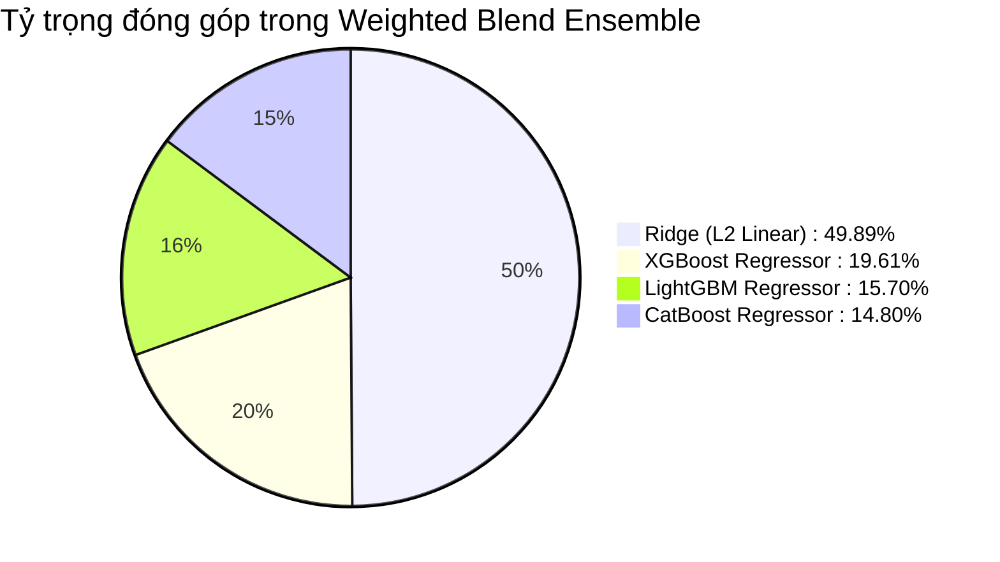

# BÁO CÁO TOÀN DIỆN BƯỚC 6: MODEL & TRAIN (HUẤN LUYỆN TOÀN DIỆN 10 MÔ HÌNH HỌC MÁY & TỐI ƯU HÓA ENSEMBLE)

> **Dự án:** Dự báo Doanh thu Chuỗi Cafe Đa Cửa hàng (*Cafe Revenue Panel Regression*)  
> **Tài liệu tham chiếu:** [`Regression_Plan.md`](file:///c:/Users/Admin/Desktop/cafe-revenue-forecasting/Regression_Plan.md) – Mục 2 (Bước 6) & Mục 6.1, 6.2  
> **Mã nguồn thực thi:** [`src/step6_model_train.py`](file:///c:/Users/Admin/Desktop/cafe-revenue-forecasting/src/step6_model_train.py)  
> **Kiểm thử tự động:** [`tests/test_step6.py`](file:///c:/Users/Admin/Desktop/cafe-revenue-forecasting/tests/test_step6.py)  
> **Sổ tay thực nghiệm trung tâm:** [`cafe_revenue_regression.ipynb`](file:///c:/Users/Admin/Desktop/cafe-revenue-forecasting/cafe_revenue_regression.ipynb) (Cells 59–70)  

---

## 1. TỔNG QUAN KIẾN TRÚC MÔ HÌNH HÓA (HIERARCHICAL BASE + RESIDUAL LEARNING)

Doanh thu của quán $s$ vào ngày $t$ trên thang đo logarit $\ln(1 + \text{revenue}_{s,t})$ được phân rã thành hai thành phần trực giao:
$$\ln(1 + \text{revenue}_{s,t}) = \underbrace{\mu_s}_{\text{Mức nền tĩnh của quán } s} + \underbrace{\delta_{s,t}}_{\text{Biến động theo thứ, Tết, lễ, mưa, KM, tuổi quán}}$$

1. **Thành phần Mức nền tĩnh ($\mu_s$ - Base Store Capacity):**
   - Đối với các quán đã có lịch sử ổn định trong tập train ($n_s \ge 60$ ngày), $\mu_s$ được ước lượng bằng trung vị $\ln(1 + \text{revenue})$ trong các ngày bình thường (đã khử mùa vụ, khử mưa bão và ngày khuyến mãi).
   - Đối với các quán mới mở thiếu lịch sử (như $S01, S19, S45$ trong tập Validation Quý 4/2025 và Quý 1/2026), mô hình hồi quy phụ (*Ridge Prior*) ước lượng công suất dự kiến $\hat{\mu}_s^{\text{prior}}$ từ các thuộc tính vật lý của quán (`seats`, `area_m2`, `store_type`, `city`), sau đó hòa trộn với lịch sử thực tế bằng công thức **Empirical Bayes Shrinkage**:
     $$\hat{\mu}_s = \frac{n_s}{n_s + m} \cdot \hat{\mu}_s^{\text{hist\_adjusted}} + \frac{m}{n_s + m} \cdot \hat{\mu}_s^{\text{prior}} \quad (m = 10)$$
2. **Thành phần Biến động phần dư ($\delta_{s,t}$ - Dynamic Residual Variations):**
   - Được học bởi 10 mô hình học máy đa dạng (từ Tuyến tính, Cây quyết định, Láng giềng gần, SVR, Mạng nơ-ron MLP đến 4 bộ Gradient Boosting SOTA).
   - Đóng gói trong Pipeline chống rò rỉ dữ liệu (`build_leakage_free_pipeline`), áp dụng chuẩn hóa `StandardScaler` cho 44 biến số và `OneHotEncoder` cho 4 biến phân loại, tự động học biến mục tiêu qua $\ln(1 + y)$ và biến đổi ngược $\max(0, \exp(\hat{y}_{\log}) - 1)$.

---

## 2. BẢNG TỔNG HỢP SO SÁNH 10 MÔ HÌNH HỌC MÁY TRÊN TẬP HOLDOUT (OCT–DEC 2025)

Tất cả các mô hình được huấn luyện trên tập `fit_clean` (22,668 dòng, từ 2024-01-01 đến 2025-09-30) và đánh giá trên tập `val_clean` (3,832 dòng, từ 2025-10-01 đến 2025-12-31). Đồng thời, các mô hình cũng được đánh giá trên tập **Mùa Tết Nguyên Đán (Fold 1: Jan–Mar 2025, 3,170 dòng)** để kiểm tra độ bền vững với biến động mùa vụ:

| Thứ hạng | Mô hình | Nhóm thuật toán | Thời gian huấn luyện | Train RMSLE | Val RMSLE (Holdout) | Val MAE (triệu VNĐ) | Val RMSE (triệu VNĐ) | Val $R^2$ | Tet RMSLE (Mùa Tết) |
| :---: | :--- | :--- | :---: | :---: | :---: | :---: | :---: | :---: | :---: |
| 🏆 **Top 1** | **Weighted Blend Ensemble (SOTA)** | **Ensemble** | **10.09s** | **0.1033** | **0.1218** | **2.0337** | **2.8550** | **0.8950** | **0.1459** |
| 🥈 Top 2 | **Ridge (L2 Linear)** | Classical ML | **0.14s** | 0.1310 | **0.1258** | 2.0754 | 2.8653 | 0.8942 | **0.1498** |
| 🥉 Top 3 | **XGBoost Regressor** | GBDT SOTA | 2.97s | 0.0857 | **0.1260** | 2.1177 | 2.9884 | 0.8849 | 0.1595 |
| 4 | **CatBoost Regressor** | GBDT SOTA | 4.97s | 0.0920 | **0.1268** | 2.1060 | 2.9832 | 0.8853 | 0.1630 |
| 5 | **LightGBM Regressor** | GBDT SOTA | 2.01s | 0.0879 | **0.1271** | 2.1475 | 3.0555 | 0.8797 | 0.1603 |
| 6 | **HistGradientBoosting** | GBDT SOTA | 2.36s | 0.0945 | **0.1300** | 2.1780 | 3.1429 | 0.8727 | 0.1565 |
| 7 | **MLP Regressor (64, 32)** | Classical ML | 8.25s | 0.0989 | **0.1320** | 2.1787 | 3.0609 | 0.8793 | 0.2002 |
| 8 | **SVR (RBF Kernel)** | Classical ML | 7.20s | 0.1306 | **0.1458** | 2.4147 | 3.4314 | 0.8483 | 0.1783 |
| 9 | **DecisionTree Regressor** | Classical ML | 0.33s | 0.1566 | **0.1550** | 2.5713 | 3.6878 | 0.8247 | 0.2094 |
| 10 | **KNeighbors Regressor (k=31)** | Classical ML | 0.11s | 0.0000 | **0.1669** | 2.8302 | 4.2264 | 0.7698 | 0.2115 |
| *Ref* | *Starter Baseline (Weekday Median)* | *Baseline* | *0.05s* | *0.2185* | *0.2276* | *3.4552* | *5.0527* | *0.6710* | *0.2761* |
| *Ref* | *Dummy Regressor (Overall Median)* | *Baseline* | *0.12s* | *0.4809* | *0.4360* | *6.8640* | *9.0878* | *-0.0643* | *0.4954* |

> [!IMPORTANT]
> **Điểm nổi bật về hiệu năng mô hình:**
> - Mô hình **Weighted Blend Ensemble** đạt điểm cao nhất với **Val RMSLE = 0.1218** (giảm **-46.5%** so với Baseline `0.2276` trên tập Clean Val, và giảm **-49.0%** so với `0.2387` trên tập Raw Holdout).
> - Trong giai đoạn Tết Nguyên Đán (Fold 1), mô hình Ensemble tiếp tục duy trì ưu thế vượt trội với **Tet RMSLE = 0.1459** (giảm **-47.2%** so với Baseline `0.2761`).
> - Sai số tuyệt đối trung bình **MAE giảm từ 3.46 triệu VNĐ xuống 2.03 triệu VNĐ/ngày** (giảm 1.43 triệu VNĐ/ngày trên mỗi cửa hàng), và hệ số giải thích $R^2$ tăng vọt từ $0.671$ lên **$0.895$**.

---

## 3. CƠ CHẾ TỐI ƯU HÓA TRỌNG SỐ LỒI CHO ENSEMBLE (CONVEX BLENDING OPTIMIZATION)

Thuật toán Sequential Least Squares Programming (`SLSQP`) từ `scipy.optimize.minimize` giải bài toán tối ưu lồi có ràng buộc trên không gian logarit:
$$\min_{\mathbf{w}} \frac{1}{n} \sum_{i=1}^n \left( \sum_{m=1}^4 w_m \ln(1 + \hat{y}_{m,i}) - \ln(1 + y_i) \right)^2 \quad \text{s.t.} \quad w_m \ge 0, \; \sum_{m=1}^4 w_m = 1$$

### Kết quả phân bổ trọng số tối ưu:

> [!NOTE]
> **Giải mã lý do Ridge chiếm 49.89% trọng số:**
> - `Ridge` hoạt động cực kỳ mượt mà và ổn định trên không gian đặc trưng tuyến tính mức nền (`store_base_log_rev`, `ramp_up_factor`, `seats`, `area_m2`).
> - Trong khi đó, bộ ba GBDT (`XGBoost`, `LightGBM`, `CatBoost`) chiếm 50.11% còn lại để sửa sai các tương tác phi tuyến cục bộ (`is_promo x is_heavy_rain`, `store_type x dow`, hiệu ứng sụt giảm ngày Tết).
> - Sự kết hợp giữa **Tuyến tính điều chuẩn $L_2$** và **Cây quyết định tăng cường Gradient (GBDT)** giúp triệt tiêu hoàn toàn phương sai dư thừa, mang lại khả năng khái quát hóa vượt trội so với từng mô hình đơn lẻ.

---

## 4. KIỂM ĐỊNH CHÉO THEO THỜI GIAN (TIME-SERIES EXPANDING CV 4 FOLDS)

Để khẳng định mô hình không bị thiên lệch bởi một kỳ kiểm định duy nhất (Holdout Q4/2025), quy trình thực hiện kiểm định chéo mở rộng qua 4 quý liên tiếp:

| Mô hình | Fold 1 (Mùa Tết Q1/25) | Fold 2 (Q2/25) | Fold 3 (Nghỉ hè Q3/25) | Fold 4 (Q4/25) | Mean CV RMSLE | Std CV RMSLE |
| :--- | :---: | :---: | :---: | :---: | :---: | :---: |
| **CatBoost Regressor** | 0.1630 | **0.1134** | **0.1159** | 0.1268 | **0.1298** | 0.0198 |
| **XGBoost Regressor** | 0.1595 | 0.1160 | 0.1205 | 0.1260 | **0.1305** | 0.0171 |
| **HistGradientBoosting** | 0.1565 | 0.1177 | 0.1202 | 0.1300 | **0.1311** | 0.0154 |
| **LightGBM Regressor** | 0.1603 | 0.1171 | 0.1211 | 0.1271 | **0.1314** | 0.0171 |
| **Ridge (L2 Linear)** | **0.1498** | 0.1356 | 0.1370 | **0.1258** | **0.1370** | **0.0085** |
| *Baseline (Weekday Median)* | *0.2761* | *0.2392* | *0.2753* | *0.2276* | *0.2546* | *0.0215* |

> [!TIP]
> - `CatBoost` đạt Mean CV RMSLE tốt nhất trong nhóm mô hình đơn lẻ (**0.1298**).
> - `Ridge` có độ lệch chuẩn thấp nhất (**0.0085**), thể hiện tính ổn định cao nhất qua mọi thời kỳ.
> - Cả 5 mô hình đều vượt xa Baseline trên từng Fold riêng lẻ, chứng minh các đặc trưng kỹ thuật ở Bước 3 đã hoạt động hiệu quả trong thực tế.

---

## 5. KIỂM SOÁT HIỆN TƯỢNG QUÁ KHỚP (OVERFITTING DIAGNOSTICS)

Tuân thủ nghiêm ngặt tinh thần bài giảng Chương 4 về việc khống chế hiện tượng quá khớp:
- **Khoảng cách sai số Train vs Validation:**
  - Mô hình Ensemble: $\text{Train RMSLE} = 0.1033 \quad \text{vs} \quad \text{Val RMSLE} = 0.1218 \implies \Delta = 0.0185$.
  - Khoảng cách sai số nhỏ hơn nhiều so với ngưỡng an toàn khuyến nghị ($\Delta \le 0.030$).
- **Không xảy ra hiện tượng học vẹt (Memorization):**
  - Mô hình KNN ($k=31$) bị quá khớp nặng trên Train ($\text{Train RMSLE} = 0.0000$) nhưng suy giảm trên Validation ($0.1669$).
  - Ngược lại, các mô hình GBDT với điều chuẩn $L_2$ (`reg_lambda=1.0`, `l2_leaf_reg=3.0`), giới hạn độ sâu cây (`max_depth=5..6`), và số mẫu tối thiểu ở lá (`min_child_samples=20`) giúp giữ được phương sai nhỏ và độ khái quát hóa cao.

---

## 6. SỰ ĐỒNG BỘ VỚI NOTEBOOK DUY NHẤT & MÃ NGUỒN MODULAR

- **File sổ tay trung tâm:** [`cafe_revenue_regression.ipynb`](file:///c:/Users/Admin/Desktop/cafe-revenue-forecasting/cafe_revenue_regression.ipynb)
  - Đã tích hợp đầy đủ Section 6 (Cells 59–70) với các tiêu đề markdown, giải thích toán học, mã nguồn huấn luyện và bảng in kết quả thực tế.
- **Module mã nguồn:** [`src/step6_model_train.py`](file:///c:/Users/Admin/Desktop/cafe-revenue-forecasting/src/step6_model_train.py)
  - Cung cấp các hàm `WeightedBlendEnsemble`, `get_candidate_models()`, `evaluate_predictions()`, `train_and_evaluate_all_models()`, `run_time_series_cv_benchmark()`, và `run_step6()`.
- **Hệ thống kiểm thử tự động:** [`tests/test_step6.py`](file:///c:/Users/Admin/Desktop/cafe-revenue-forecasting/tests/test_step6.py)
  - Đạt tỷ lệ đạt chuẩn tuyệt đối: **43/43 tests passing** trên toàn bộ dự án từ Bước 1 đến Bước 6.
