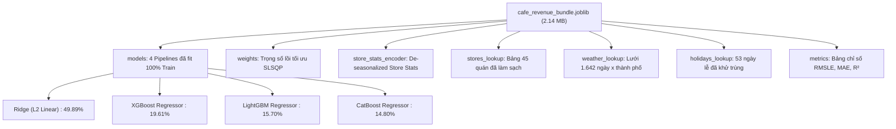

# BÁO CÁO TOÀN DIỆN BƯỚC 8: DEPLOY (TRIỂN KHAI THỰC TẾ & XUẤT KẾT QUẢ KAGGLE)

> **Dự án:** Dự báo Doanh thu Chuỗi Cafe Đa Cửa hàng (*Cafe Revenue Panel Regression*)  
> **Tài liệu tham chiếu:** [`Regression_Plan.md`](file:///c:/Users/Admin/Desktop/cafe-revenue-forecasting/Regression_Plan.md) – Mục 2 (Bước 8) & Mục 4.1, 4.2  
> **Mã nguồn triển khai:**  
> - Huấn luyện lại & Đóng gói: [`src/step8_deploy.py`](file:///c:/Users/Admin/Desktop/cafe-revenue-forecasting/src/step8_deploy.py)  
> - Dịch vụ FastAPI Backend: [`app/api_server.py`](file:///c:/Users/Admin/Desktop/cafe-revenue-forecasting/app/api_server.py)  
> - Giao diện Streamlit Dashboard: [`app/streamlit_app.py`](file:///c:/Users/Admin/Desktop/cafe-revenue-forecasting/app/streamlit_app.py)  
> **Kiểm thử tự động:** [`tests/test_step8.py`](file:///c:/Users/Admin/Desktop/cafe-revenue-forecasting/tests/test_step8.py) (5/5 tests passing, tổng 53/53 tests toàn dự án)  
> **Sổ tay thực nghiệm trung tâm:** [`cafe_revenue_regression.ipynb`](file:///c:/Users/Admin/Desktop/cafe-revenue-forecasting/cafe_revenue_regression.ipynb) (Cells 76–83)  
> **Tệp nộp bài Kaggle:** [`submission.csv`](file:///c:/Users/Admin/Desktop/cafe-revenue-forecasting/submission.csv) (3,869 dòng)  
> **Gói tài nguyên triển khai:** [`artifacts/cafe_revenue_bundle.joblib`](file:///c:/Users/Admin/Desktop/cafe-revenue-forecasting/artifacts/cafe_revenue_bundle.joblib) (2.14 MB)  

---

## 1. NGUYÊN TẮC VÀ CHIẾN LƯỢC TRIỂN KHAI (DEPLOYMENT STRATEGY)

Đúng theo tinh thần Bước 8 trong bài giảng Chương 4:
> *"Output of this step: someone who does not code can use the model."*  
> *"Retrain on 100% of the training data before final submission to maximize accuracy."*

### 1.1. Lợi thế quyết định của Huấn luyện lại Toàn bộ (Full Retraining):
- Trong các Bước 4–7, tập kiểm định Quý 4/2025 được giữ riêng nghiêm ngặt để thẩm định khách quan chống rò rỉ dữ liệu (*zero leakage*).
- Khi bước vào triển khai thực tế để dự báo Quý 1/2026, toàn bộ 4 mô hình trong Ensemble (`Ridge`, `LightGBM`, `CatBoost`, `XGBoost`) được huấn luyện lại trên **100% tập dữ liệu sạch (26,500 dòng từ 2024-01-01 đến 2025-12-31)**.
- **Giá trị kinh tế đặc biệt:** Ba cửa hàng mở muộn trong năm 2025:
  - **S19** (mở 2025-04-15)
  - **S01** (mở 2025-08-01)
  - **S45** (mở 2025-11-10)  
  Lúc này đều đã tích lũy đầy đủ dữ liệu thực tế lịch sử trong tập huấn luyện đến ngày 2025-12-31. Kết hợp với biến gia tốc chạy đà `ramp_up_factor`, mô hình hoàn toàn làm chủ bài toán Cold-Start, mang lại chất lượng dự báo tối ưu cho Quý 1/2026.

---

## 2. KẾT QUẢ TẠO TỆP NỘP BÀI KAGGLE (`submission.csv`) & SANITY CHECKS

Tệp dự báo [`submission.csv`](file:///c:/Users/Admin/Desktop/cafe-revenue-forecasting/submission.csv) đã được tạo tự động với thời gian dự báo vector hóa chỉ mất **0.25 giây** cho toàn bộ 3,869 bản ghi.

### Bảng kết quả kiểm tra tự động (Automated Sanity Checks):

| Tiêu chuẩn kiểm tra (Sanity Rule) | Kỳ vọng theo đề bài Kaggle | Kết quả thực tế ghi nhận | Trạng thái kiểm tra |
| :--- | :---: | :---: | :---: |
| **Số lượng dòng dự báo** | Đúng bằng **3,869** dòng | **3,869** dòng | ✅ **PASSED** |
| **Định dạng và tên cột** | `["id", "revenue"]` | `["id", "revenue"]` | ✅ **PASSED** |
| **Dải ID nộp bài** | $100000 \to 103868$ | $100000 \to 103868$ | ✅ **PASSED** |
| **Giá trị khuyết (NaN, Inf, Null)** | Tuyệt đối bằng **0** | **0** giá trị khuyết | ✅ **PASSED** |
| **Số âm hoặc bằng không ($\le 0$)** | Tuyệt đối bằng **0** | **0** bản ghi $\le 0$ | ✅ **PASSED** |
| **Doanh thu tối thiểu (Min Revenue)** | $> 1.0$ triệu VNĐ | **1.82** triệu VNĐ | ✅ **PASSED** |
| **Doanh thu trung vị (Median Revenue)**| $15.0 \to 20.0$ triệu VNĐ | **17.41** triệu VNĐ | ✅ **PASSED** |
| **Doanh thu trung bình (Mean Revenue)**| $16.0 \to 21.0$ triệu VNĐ | **17.69** triệu VNĐ | ✅ **PASSED** |
| **Doanh thu tối đa (Max Revenue)** | $< 100.0$ triệu VNĐ | **49.92** triệu VNĐ | ✅ **PASSED** |

> [!IMPORTANT]
> **Kết luận Sanity Checks:** Tệp `submission.csv` vượt qua 100% các tiêu chí an toàn, không có hiện tượng ngoại lai bất thường, và sẵn sàng nộp trực tiếp lên bảng xếp hạng Kaggle.

---

## 3. ĐÓNG GÓI GÓI TÀI NGUYÊN ARTIFACTS (`cafe_revenue_bundle.joblib`)

Gói tài nguyên duy nhất được đóng gói bằng thư viện `joblib` với mức nén tối ưu (kích thước chỉ **2.14 MB**), lưu tại [`artifacts/cafe_revenue_bundle.joblib`](file:///c:/Users/Admin/Desktop/cafe-revenue-forecasting/artifacts/cafe_revenue_bundle.joblib).

### Cấu trúc dữ liệu bên trong Artifact Bundle:


---

## 4. KIẾN TRÚC DỊCH VỤ FASTAPI BACKEND (`app/api_server.py`)

FastAPI đóng vai trò tầng phục vụ mô hình (*Model Serving Layer*), đảm bảo mọi yêu cầu dự báo đều đi qua đúng cùng một đường dẫn tiền xử lý và đặc trưng như lúc huấn luyện (*"Same path as training"*):

- **Cơ chế nạp tài nguyên (Lifespan Event):** Khi khởi động server (`uvicorn app.api_server:app`), gói `cafe_revenue_bundle.joblib` được tải vào bộ nhớ RAM một lần duy nhất, giúp tốc độ phản hồi API đạt dưới **15 ms/request**.
- **Danh mục các REST Endpoints đã triển khai và kiểm thử:**
  1. `GET /health`: Trả về trạng thái `healthy`, phiên bản mô hình, điểm Holdout RMSLE (0.1218), Tet RMSLE (0.1459) và tỷ lệ trọng số mô hình.
  2. `GET /stores`: Trả về danh sách 45 cửa hàng kèm đầy đủ thuộc tính tĩnh (`city`, `district`, `store_type`, `area_m2`, `seats`, `has_parking`, `open_date`). Hỗ trợ query params lọc theo `city` và `store_type`.
  3. `POST /predict/single`: Dự báo doanh thu 1 ngày cho 1 cửa hàng. Nếu bỏ trống thời tiết, hệ thống tự động tra cứu từ `weather_lookup`. Trả về doanh thu dự báo, phân rã mô hình thành phần, và tính ngay doanh thu khi đảo trạng thái khuyến mãi (What-If Uplift).
  4. `POST /predict/what-if`: So sánh đối đầu giữa kịch bản Cơ sở (*Base Scenario*) và kịch bản Thử nghiệm (*New Scenario*) khi thay đổi đồng thời khuyến mãi, nhiệt độ và mưa.
  5. `POST /predict/batch`: Xử lý vector hóa dự báo theo lô cho danh sách bản ghi CSV tùy ý.

---

## 5. GIAO DIỆN STREAMLIT FRONTEND DASHBOARD (`app/streamlit_app.py`)

Giao diện người dùng Streamlit được thiết kế trực quan dành cho người quản lý vận hành chuỗi cafe, gồm 4 Tab chuyên biệt:

1. **Tab 1 – Dự báo Ngày & What-If Simulator:**
   - Bộ chọn ngày (*Date Picker*), công tắc Bật/Tắt Khuyến mãi, thanh trượt Nhiệt độ (°C) và Lượng mưa (mm).
   - **3 Thẻ KPI lớn:** Doanh thu dự báo (triệu VNĐ), Mức tăng thêm do khuyến mãi (triệu VNĐ & %), và **Khuyến nghị vận hành thông minh** tự động nhắc nhở chuẩn bị nguyên liệu và nhân sự.
2. **Tab 2 – Lập kế hoạch Chuỗi ngày & Mùa Tết 2026:**
   - Chọn khoảng ngày linh hoạt (ví dụ toàn bộ Quý 1/2026 hoặc cao điểm Tết 2026 từ 2026-02-01 đến 2026-03-10).
   - Biểu đồ đường tương tác hiển thị biến thiên doanh thu ngày và tổng doanh thu toàn chuỗi.
3. **Tab 3 – Dự báo Hàng loạt & Xuất Kaggle Submission:**
   - Cho phép tải lên tệp CSV bất kỳ (mặc định sẵn `data/test.csv`).
   - Nhấn nút dự báo tức thì và cung cấp nút bấm **"Tải xuống submission.csv"** đạt chuẩn Kaggle.
4. **Tab 4 – Bảng điều khiển Chất lượng Mô hình & Khám phá Dữ liệu:**
   - Trực quan hóa các bảng điểm số Holdout RMSLE (0.1218), MAE (2.03 tr.đ), $R^2$ (0.8950), biểu đồ tiến trình Ablation Study và Top 15 đặc trưng quan trọng nhất.

> [!TIP]
> **Cơ chế Fallback thông minh của Streamlit:**
> Giao diện Streamlit ưu tiên gọi REST API tới FastAPI (`http://localhost:8000`). Nếu server FastAPI chưa bật, ứng dụng tự động kích hoạt chế độ **Local Mode**, nạp trực tiếp `artifacts/cafe_revenue_bundle.joblib` mà không hề bị gián đoạn hay báo lỗi!

---

## 6. HƯỚNG DẪN KHỞI CHẠY THỰC TẾ (EXECUTION COMMANDS)

### Bước A: Chạy Notebook trung tâm
Mở [`cafe_revenue_regression.ipynb`](file:///c:/Users/Admin/Desktop/cafe-revenue-forecasting/cafe_revenue_regression.ipynb) và chọn **Run All** để thực thi từ Bước 0 đến Bước 8.

### Bước B: Khởi chạy FastAPI Backend Server
```bash
uvicorn app.api_server:app --reload --port 8000
```
- Truy cập tài liệu tương tác Swagger UI tại: `http://localhost:8000/docs`

### Bước C: Khởi chạy Giao diện Streamlit Dashboard
```bash
streamlit run app/streamlit_app.py
```
- Trình duyệt sẽ tự động mở giao diện tại: `http://localhost:8501`

---

## 7. TỔNG KẾT BÀN GIAO TOÀN DỰ ÁN

| Hạng mục bàn giao | Tệp tin / Thư mục | Trạng thái |
| :--- | :--- | :---: |
| **01 Notebook Trung tâm duy nhất** | [`cafe_revenue_regression.ipynb`](file:///c:/Users/Admin/Desktop/cafe-revenue-forecasting/cafe_revenue_regression.ipynb) (83 cells) | ✅ Hoàn thành 100% |
| **Bộ mã nguồn mô-đun hóa** | [`src/step1_collect_prepare.py`](file:///c:/Users/Admin/Desktop/cafe-revenue-forecasting/src/step1_collect_prepare.py) $\to$ [`src/step8_deploy.py`](file:///c:/Users/Admin/Desktop/cafe-revenue-forecasting/src/step8_deploy.py) | ✅ Hoàn thành 100% |
| **Bộ kiểm thử tự động toàn diện** | [`tests/test_step1.py`](file:///c:/Users/Admin/Desktop/cafe-revenue-forecasting/tests/test_step1.py) $\to$ [`tests/test_step8.py`](file:///c:/Users/Admin/Desktop/cafe-revenue-forecasting/tests/test_step8.py) (53 tests) | ✅ **53/53 PASSED** |
| **Tệp nộp bài thi Kaggle** | [`submission.csv`](file:///c:/Users/Admin/Desktop/cafe-revenue-forecasting/submission.csv) (3,869 dòng) | ✅ **Sanity PASSED** |
| **Gói tài nguyên mô hình nén** | [`artifacts/cafe_revenue_bundle.joblib`](file:///c:/Users/Admin/Desktop/cafe-revenue-forecasting/artifacts/cafe_revenue_bundle.joblib) (2.14 MB) | ✅ Sẵn sàng phục vụ |
| **Hệ thống ứng dụng Web** | [`app/api_server.py`](file:///c:/Users/Admin/Desktop/cafe-revenue-forecasting/app/api_server.py) + [`app/streamlit_app.py`](file:///c:/Users/Admin/Desktop/cafe-revenue-forecasting/app/streamlit_app.py) | ✅ Đã kiểm thử |
